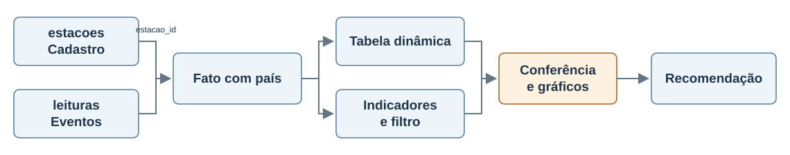
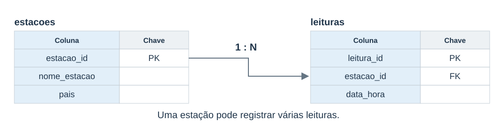
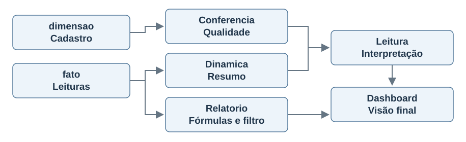
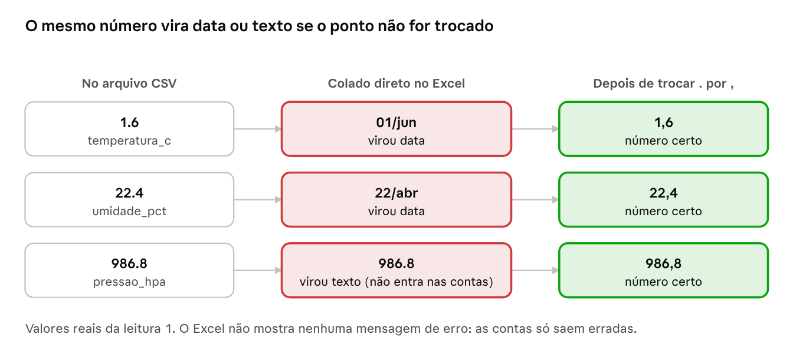
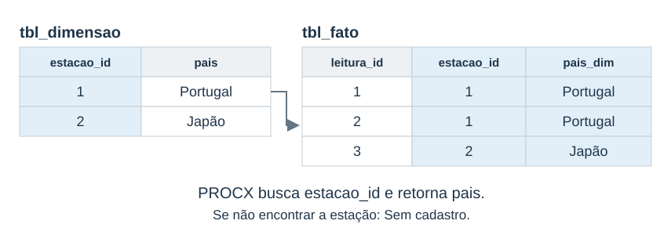
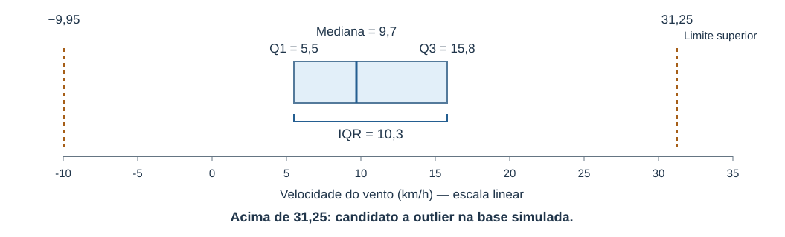

# Guia do Desafio 3 — Serviço Meteorológico
**Relatório dinâmico no Excel | Curso de Analista de Dados**

Neste desafio, você vai transformar dados meteorológicos em um relatório que outra pessoa consegue consultar, filtrar e interpretar. O objetivo não é apenas preencher células: é compreender de onde cada indicador vem e conferir se ele responde à pergunta de negócio. Este guia é independente dos anteriores.

## 1. Entenda o problema e a entrega

**Objetivo:** saber qual pergunta o relatório responde e o que precisa ser entregue.

A rede fictícia de estações registra velocidade do vento, condição do tempo e outras medidas. Queremos identificar a partir de qual velocidade uma leitura é incomum e em quais condições reforçar o monitoramento. Usaremos a velocidade do vento em km/h como métrica principal. Os dados são simulados; o relatório não estabelece um alerta meteorológico real.

Na sessão síncrona, prepare a base, confira sua qualidade, monte uma tabela dinâmica, aplique funções de busca e de cálculo por critério, formatação condicional e registre as primeiras leituras. Na parte assíncrona, complete fórmulas, trate texto, vazios e datas, aplique validação de dados, confira a tabela dinâmica, construa dois gráficos e escreva a recomendação apoiada em pelo menos duas medidas. Entregue a pasta de trabalho .xlsx no GitHub e o link no Canvas no mesmo dia, conforme o roteiro.

**Divergências do roteiro:** a introdução menciona PROCV com SEERRO, mas a etapa prática usa PROCX; a apresentação também chama o Dashboard de diferencial, enquanto a parte final pede dois gráficos nessa aba. Neste guia adotamos PROCX, que corresponde ao projeto documentado, explicamos PROCV como alternativa e incluímos o Dashboard para atender à versão mais completa. Confirme com o instrutor se PROCV também precisa ser demonstrado.

Com a entrega clara, vamos ver os dados que vão alimentar o relatório.

## 2. Conheça a base oficial

**Objetivo:** saber o que cada tabela guarda e como elas se ligam.

Baixe os arquivos [estacoes.csv](../bases_dados/06-servico-meteorologico/estacoes.csv) e [leituras.csv](../bases_dados/06-servico-meteorologico/leituras.csv). Não use a base gerada no Desafio 1. Abra uma cópia do [modelo do Excel](../exercicios/Desafio3_Excel_Modelo%20Copiar.xlsx), sem modificar o original. A [planilha de referência](../exercicios/Desafio3_Excel_Relatorio_Dinamico.xlsx) mostra o relatório pronto; use-a para comparar, não para copiar.

| Tabela | Unidade de observação | Colunas |
|---|---|---|
| estacoes | Uma estação (10.050 linhas) | estacao_id, nome_estacao, cidade, pais, latitude, longitude, altitude_m |
| leituras | Uma leitura (62.000 linhas) | leitura_id, estacao_id, data_hora, condicao_tempo, temperatura_c, umidade_pct, precipitacao_mm, velocidade_vento_kmh, pressao_hpa |

O ID da estação é único no cadastro, mas pode repetir nas leituras: uma estação registra vários eventos. A chave primária da fato é leitura_id. A coluna estacao_id da fato é a chave estrangeira. Cada leitura deve encontrar sua estação.



*Sequência das etapas do desafio.*




*Esquema parcial das colunas: cada leitura pertence a uma estação existente.*

Sabendo o que temos, podemos planejar onde cada coisa vai ficar na pasta de trabalho.

## 3. Planeje a pasta de trabalho

**Objetivo:** pensar em quem vai usar o relatório e organizar as abas antes de começar as fórmulas.

Antes de abrir o Excel, pense em quem vai consultar esse relatório. Imagine alguém da equipe de monitoramento da rede de estações, que não fez a análise. Essa pessoa quer responder rápido a três perguntas:

- Qual é o vento normal da rede e a partir de quanto ele é incomum?
- Em qual condição do tempo os ventos fortes aparecem mais?
- Isso muda no país que ela acompanha?

Cada pergunta vira uma parte do relatório: indicadores gerais, comparação por condição e um filtro de país. Tudo o que não ajuda a responder a essas perguntas fica nas abas de apoio (dados e conferência), e não no Dashboard. Essa pessoa também precisa entender os números sem perguntar a você, então cada indicador precisa de nome, unidade e uma frase de leitura.

| Aba | Responsabilidade |
|---|---|
| dimensao | Dados das estações, tabela tbl_dimensao |
| fato | Leituras, tabela tbl_fato e colunas calculadas |
| Conferencia | Quantidades, tipos, chaves e auditoria |
| Dinamica | Tabela dinâmica para resumir a base |
| Relatorio | Fórmulas, indicadores e filtro de país |
| Leitura | Pergunta, decisões de tratamento, insights e recomendação |
| Dashboard | Indicadores e gráficos para consulta |

Os endereços deste guia são os mesmos da planilha de referência:

| Onde | O que fica ali |
|---|---|
| Relatorio!B2 | País escolhido no filtro |
| Relatorio!A5:A8 | As quatro condições do tempo |
| Relatorio!B5:D8 | Quantidade, soma e média gerais por condição |
| Relatorio!E5:G8 | Quantidade, soma e média no país escolhido |
| Relatorio!J5 a J9 | Soma, média, quantidade, limite de vento forte e leituras acima do limite |
| Relatorio!J10 a J13 | Mediana, Q1, Q3 e IQR (células auxiliares) |

> **Atenção:** o modelo é o mesmo para todos os temas do curso. Por isso, alguns rótulos vêm com nomes de outro tema, como "Total de multas" e "Média por empréstimo" na coluna I do Relatorio. Troque pelos nomes do nosso tema (Soma do vento, Vento médio, e assim por diante). O modelo também reserva só duas linhas para as categorias, com o Total na linha 7. Como temos quatro condições, insira duas linhas antes do Total, para ele ficar na linha 9.



*Cada aba tem uma finalidade; os dados alimentam as conferências e o relatório.*

Com as abas planejadas, o primeiro passo prático é trazer os dados para dentro delas.

## 4. Importe sem alterar os valores

**Objetivo:** colar as duas tabelas no Excel sem que números virem datas ou texto.

O arquivo usa UTF-8 e ponto decimal (8.7); o Excel em português pode esperar vírgula (8,7). Se o programa confundir o valor com uma data ou texto, as médias poderão sair incorretas. Não basta olhar a aparência.

No Excel para a Web, siga o procedimento do roteiro: abra cada CSV em uma pasta temporária e copie seus dados para o modelo. Se necessário, converta uma cópia para UTF-8 com BOM usando um editor de texto que permita escolher a codificação. O BOM auxilia o reconhecimento de acentos. Preserve os originais.

Se o CSV abrir em uma única coluna, utilize Dados > Texto para Colunas (se disponível) e selecione o delimitador adequado. Quando a interface não permitir configurar separadores, utilize a preparação prevista no roteiro: numa cópia em texto, converta delimitadores de vírgula para ponto e vírgula e pontos decimais para vírgulas **somente quando confirmar que esses caracteres são delimitadores ou decimais, e não conteúdo de campos**. Não faça substituição global sobre campos textuais entre aspas ou sobre números já convertidos em datas. Como alternativa, no Excel desktop, Dados > De Texto/CSV permite selecionar delimitador, UTF-8 e converter as colunas numéricas com a localidade apropriada ao ponto decimal, quando disponível.

Cole estacoes em dimensao!A1 e leituras em fato!A1. Confira os cabeçalhos, nomes com acento, datas e números. A primeira leitura registrada no notebook de referência tem vento 8,7, temperatura 1,6 e pressão 986,8. São bons pontos de comparação. Se 1,6 aparecer como data, reimporte a partir do arquivo original; apenas formatar a data como número não recupera o valor.




*Figura do guia anterior: o comportamento ilustrado depende da localidade e do método de importação. Preserve os CSV originais e configure os separadores antes de converter valores.*

Os dados estão no Excel. Antes de calcular, vamos organizá-los e conferir se chegaram inteiros.

## 5. Transforme os dados em tabelas e confira a qualidade

**Objetivo:** transformar os dados em tabelas nomeadas e conferir quantidades, vazios e chaves.

Selecione uma célula dos dados, use Inserir > Tabela (ou Ctrl+T), marque que há cabeçalhos e confirme o intervalo. Em Design da Tabela, nomeie a dimensão tbl_dimensao e a fato tbl_fato. Assim as fórmulas acompanham o crescimento da tabela.

Uma referência como tbl_fato[velocidade_vento_kmh] representa toda a coluna, enquanto [@velocidade_vento_kmh] representa o valor da linha atual. Essa diferença será importante para indicadores e classificações.

> **Na prática — como escrever uma fórmula:** clique na célula, digite a fórmula começando por `=` e aperte Enter. Para repetir a fórmula nas linhas de baixo, clique na célula, pare o mouse no quadradinho do canto inferior direito (a alça de preenchimento) e arraste para baixo; o Excel ajusta as referências de cada linha. Dentro de uma tabela, como tbl_fato, isso não é necessário: ao escrever a fórmula na primeira linha de uma coluna nova, o Excel preenche a coluna inteira sozinho.

Na aba Conferencia, use as fórmulas abaixo. Elas são apresentadas em português, com ponto e vírgula entre argumentos; o Excel em outra localidade pode exigir outros nomes e separadores.

| O que conferir | Fórmula | Esperado antes de acrescentar colunas |
|---|---|---|
| Linhas dimensão | =LINS(tbl_dimensao) | 10.050 |
| Colunas dimensão | =COLS(tbl_dimensao) | 7 |
| Linhas fato | =LINS(tbl_fato) | 62.000 |
| Colunas fato | =COLS(tbl_fato) | 9 |
| Velocidades numéricas | =CONT.NÚM(tbl_fato[velocidade_vento_kmh]) | 62.000 |
| Velocidades vazias | =CONTAR.VAZIO(tbl_fato[velocidade_vento_kmh]) | 0 |

A contagem de colunas aumentará quando criarmos campos derivados. Registre a contagem inicial como conferência do esquema original.

Verifique as chaves antes de buscar países. Na versão com matrizes dinâmicas, compare a quantidade de IDs únicos com o total de linhas:

```excel
=SE(E(LINS(ÚNICO(tbl_dimensao[estacao_id]))=LINS(tbl_dimensao);CONTAR.VAZIO(tbl_dimensao[estacao_id])=0);"Todos são únicos e preenchidos";"Revisar")
=SE(E(LINS(ÚNICO(tbl_fato[leitura_id]))=LINS(tbl_fato);CONTAR.VAZIO(tbl_fato[leitura_id])=0);"Todos são únicos e preenchidos";"Revisar")
```

ÚNICO devolve os valores distintos, sem comparar todos os registros entre si. A documentação anterior usava essa estratégia para evitar lentidão de CONT.SE em grandes matrizes. Confira também se não há estacao_id vazio na fato. A correspondência de todas as chaves será verificada na etapa de busca. Não continue com uma dimensão duplicada: uma busca poderia devolver apenas a primeira ocorrência e esconder o problema.

> **Ponto de verificação:** a aba Conferencia mostra 10.050 e 62.000 linhas, 7 e 9 colunas, 62.000 velocidades numéricas, 0 vazias e "Todos são únicos e preenchidos" nas duas chaves.

A base está conferida. Agora podemos começar a resumir as leituras.

## 6. Construa a primeira tabela dinâmica

**Objetivo:** resumir quantidade e vento médio por condição do tempo sem escrever fórmulas.

Antes de usar fórmulas, pense no que deseja resumir: para cada condição, quantas leituras existem e qual a velocidade média? Imagine duas leituras de sol (8 e 10) e duas de tempestade (30 e 40). Contamos dois registros em cada grupo e calculamos médias de 9 e 35 km/h. A tabela dinâmica automatiza isso.

Clique em tbl_fato e escolha Inserir > Tabela Dinâmica > Da Tabela/Intervalo. Posicione na aba Dinamica. No painel de campos:
- Linhas: condicao_tempo.
- Valores: leitura_id resumido por Contagem; velocidade_vento_kmh resumida por Média e, para auditoria, por Soma.
- Formate médias com duas casas decimais e ordene pela média decrescente.

| Condição | Quantidade esperada | Média esperada (km/h) |
|---|---:|---:|
| tempestade | 1.848 | 27,88 |
| chuvoso | 5.604 | 14,29 |
| nublado | 31.020 | 12,02 |
| ensolarado | 23.528 | 10,02 |

Resultados de referência registrados no notebook do Desafio 2. O total é 62.000 leituras e a média geral arredondada é 11,94. Não calcule a média geral fazendo a média simples das quatro médias: os grupos têm tamanhos diferentes. A soma dos valores de vento é útil para conferir cálculos, mas não é velocidade acumulada nem indicador de risco.

A tabela dinâmica resume por condição, que já está na tabela de leituras. Para filtrar por país, precisamos trazer essa informação do cadastro.

## 7. Traga o país para cada leitura

**Objetivo:** buscar o país de cada leitura no cadastro de estações e conferir se nenhuma ficou sem cadastro.

O país está na dimensão, não na fato. Para filtrar as leituras por país, precisamos buscá-lo pelo estacao_id.

| leitura_id | estacao_id | vento | pais_dim após busca |
|---|---:|---:|---|
| 1 | 1 | 8 | Portugal |
| 2 | 1 | 30 | Portugal |
| 3 | 2 | 12 | Japão |

Exemplo ilustrativo: a estação 1 pertence a Portugal e a 2 ao Japão. O ID usado na busca é estacao_id, não leitura_id.




*Exemplo fictício de PROCX por estacao_id.*

Crie a coluna pais_dim na primeira coluna vazia ao lado de tbl_fato. Digite:

```excel
=PROCX([@estacao_id];tbl_dimensao[estacao_id];tbl_dimensao[pais];"Sem cadastro";0)
```

O primeiro argumento é o ID da linha. O segundo é onde procurar; o terceiro é a coluna a retornar; o quarto define o texto para ausência de correspondência; zero solicita correspondência exata. A tabela deve preencher a coluna toda.

A planilha de referência usa uma busca binária (último argumento 2). Na busca normal, o Excel olha os IDs um por um, do primeiro até achar. Na binária, ele abre a lista no meio, vê se o ID procurado é maior ou menor e descarta a metade errada, repetindo até achar. Com 62.000 buscas em 10.050 estações, isso deixa a planilha bem mais rápida. O porém é que esse método só funciona se os IDs estiverem em ordem crescente. Fora de ordem, ele pode devolver o país errado sem mostrar erro. Use-a somente depois de confirmar a ordem:
```excel
=PROCX([@estacao_id];tbl_dimensao[estacao_id];tbl_dimensao[pais];"Sem cadastro";0;2)
```
Se o instrutor exigir PROCV, a alternativa para a estrutura original (ID na primeira coluna e país na quarta) é:
```excel
=SEERRO(PROCV([@estacao_id];tbl_dimensao;4;FALSO);"Sem cadastro")
```
FALSO pede correspondência exata; SEERRO substitui erros por um texto. Não esconda problemas: na aba Conferencia, conte os casos sem cadastro:
```excel
=CONT.SE(tbl_fato[pais_dim];"Sem cadastro")
```
> **Ponto de verificação:** o resultado é zero. Se não for, confira IDs, tipos numéricos/textuais, duplicidades e ordenação antes de avançar.

Com o país em cada leitura, podemos montar o relatório com fórmulas que respondem ao filtro.

## 8. Reproduza a tabela dinâmica com fórmulas

**Objetivo:** calcular quantidade, soma e média por condição com fórmulas, na rede toda e no país escolhido.

Na aba Relatorio, escreva as quatro condições em A5:A8. Reserve B, C e D para quantidade, soma e média gerais por condição. Em B5, C5 e D5, respectivamente:
```excel
=CONT.SE(tbl_fato[condicao_tempo];$A5)
=SOMASE(tbl_fato[condicao_tempo];$A5;tbl_fato[velocidade_vento_kmh])
=SEERRO(MÉDIASE(tbl_fato[condicao_tempo];$A5;tbl_fato[velocidade_vento_kmh]);"-")
```
Arraste até a linha 8. O primeiro argumento de CONT.SE é a coluna a examinar; o segundo, a condição escolhida. SOMASE soma o vento apenas das linhas que atendem à condição. MÉDIASE faz a média dessas linhas. O símbolo $ fixa a coluna A ao copiar a fórmula; a linha muda. SEERRO evita mostrar #DIV/0! se o grupo não tiver valores, mas o traço indica ausência de cálculo, não velocidade zero.

Agora preencha B2 com Brasil. Queremos comparar as mesmas condições **somente** no país selecionado. Em E5, F5 e G5:
```excel
=CONT.SES(tbl_fato[condicao_tempo];$A5;tbl_fato[pais_dim];$B$2)
=SOMASES(tbl_fato[velocidade_vento_kmh];tbl_fato[condicao_tempo];$A5;tbl_fato[pais_dim];$B$2)
=SEERRO(MÉDIASES(tbl_fato[velocidade_vento_kmh];tbl_fato[condicao_tempo];$A5;tbl_fato[pais_dim];$B$2);"-")
```
Arraste até a linha 8. As versões com S aceitam vários critérios simultâneos. SOMASES e MÉDIASES recebem primeiro a coluna numérica, depois pares de coluna e critério. $B$2 fixa a célula do país em todas as linhas. Ao mudar B2, somente a visão filtrada deve mudar.

> **Ponto de verificação:** com B2 = Brasil, as colunas B a D mostram os mesmos números da tabela dinâmica, e as colunas E a G mostram números menores na quantidade e parecidos na média.

As médias por condição já mostram onde venta mais. Falta definir a partir de quanto um vento é incomum.

## 9. Calcule indicadores e defina um ponto de atenção

**Objetivo:** calcular os indicadores gerais e o limite de vento incomum pela regra do IQR.

Não é preciso ter feito o Desafio 2 para esta etapa. Vamos retomar as medidas com cinco leituras fictícias, em km/h, já em ordem: 4, 6, 6, 10 e 34.

| Medida | Conta | Resultado |
|---|---|---:|
| Média | (4+6+6+10+34) / 5 | 12 |
| Mediana | o valor do meio (3ª posição) | 6 |
| Q1 | o valor na 2ª posição | 6 |
| Q3 | o valor na 4ª posição | 10 |
| IQR | Q3 − Q1 = 10 − 6 | 4 |
| Limite superior | Q3 + 1,5 × IQR = 10 + 6 | 16 |

Quatro das cinco leituras estão entre 4 e 10, mas a média deu 12, porque o 34 puxa ela para cima. A mediana, 6, continua no meio dos dados. Os quartis marcam a faixa onde está a metade central das leituras, e o limite superior diz até onde um valor ainda é comum. Só o 34 passa de 16, então só ele é candidato a valor incomum. Se o 34 fosse 100, a média subiria, mas os quartis e o limite continuariam iguais.

Na base real, a lógica é a mesma. Nas células da coluna J do Relatorio, crie os indicadores gerais (com o nome de cada um ao lado, na coluna I):
```excel
=SOMA(tbl_fato[velocidade_vento_kmh])
=MÉDIA(tbl_fato[velocidade_vento_kmh])
=CONT.NÚM(tbl_fato[velocidade_vento_kmh])
```
Em J5, J6 e J7, respectivamente. Esperado: 740.166,8 (soma aritmética dos registros), 11,94 km/h e 62.000.

Depois, nas células auxiliares J10 a J13, calcule a mediana, o Q1, o Q3 e o IQR:
```excel
=MED(tbl_fato[velocidade_vento_kmh])
=QUARTIL.INC(tbl_fato[velocidade_vento_kmh];1)
=QUARTIL.INC(tbl_fato[velocidade_vento_kmh];3)
=J12-J11
```
E em J8, o limite:
```excel
=J12+1,5*J13
```
Esperamos mediana 9,70, Q1 5,5, Q3 15,8, IQR 10,3 e limite 31,25 km/h. Na planilha de referência, o 31,25 foi digitado direto em J8; com a fórmula, o limite se atualiza sozinho se a base mudar. A regra é exploratória, não um limiar meteorológico real.

> **Decisão técnica:** o Excel tem duas funções de quartil, QUARTIL.INC e QUARTIL.EXC, e elas dão resultados um pouco diferentes. Usamos QUARTIL.INC porque ela calcula do mesmo jeito que o pandas no Desafio 2. Assim, o limite do Excel e o do Python batem: 31,25 km/h nos dois.

Em J9, conte as leituras que ultrapassam o limite:
```excel
=CONT.SE(tbl_fato[velocidade_vento_kmh];">"&J8)
```
Esperado: 2.300. O & monta um critério com o valor de J8; o operador é estritamente maior. Dividindo pelo total, obtemos aproximadamente 3,7%.

Selecione as velocidades na fato e use Página Inicial > Formatação Condicional > regra de maior que, referenciando Relatorio!J8 (ou uma célula auxiliar local vinculada a ela se a interface impedir referência a outra aba). Se disponível, use uma regra por fórmula com referência relativa à primeira célula de dados e absoluta ao limite. Confira se 31,25 não é marcado e se valores superiores são marcados. Não use a cor como único indicador.




*Valores da base fictícia de referência. O limite superior é exploratório, não um alerta real.*

Com o limite definido, podemos classificar cada leitura. Antes, vamos garantir que texto, vazios e datas não atrapalhem essa classificação.

## 10. Trate texto, vazios e datas

**Objetivo:** criar colunas que limpam o texto, classificam o vento e separam mês e ano.

A mesma condição escrita com um espaço final pode virar categoria separada. Uma célula vazia não é o mesmo que vento zero. Uma data precisa ser reconhecida como data para extrair mês e ano.

Adicione as colunas abaixo na tbl_fato:
```excel
=ARRUMAR([@condicao_tempo])
=SE(ÉCEL.VAZIA([@velocidade_vento_kmh]);"Sem leitura";SE([@velocidade_vento_kmh]>Relatorio!$J$8;"Vento forte";"Vento normal"))
=MÊS([@data_hora])
=ANO([@data_hora])
```
Nomeie os campos condicao_limpa, faixa_vento, mes e ano. A primeira fórmula remove espaços excedentes; compare com o original para descobrir se houve mudança. A segunda testa primeiro se o vento está vazio, depois se supera o limite. A terceira e a quarta extraem partes da data. A base atravessa dois anos: agrupar somente por mês mistura janeiro de 2025 com janeiro de 2026. Para análise temporal use ano e mês juntos, não uma série horária por estação, pois as leituras não são periódicas.

Não apague os valores altos automaticamente. O notebook de referência mostra que o máximo é 157,4 km/h e os extremos são relevantes para a pergunta. Registre que não havia vazios na execução de referência, que os candidatos a outlier foram preservados e que a classificação é relativa ao limite simulado. Se a sua conferência apresentar divergências, investigue a importação antes de repetir essas conclusões.

Os cálculos estão prontos. Antes de mostrar os resultados, precisamos proteger o filtro e conferir se os dois caminhos (tabela dinâmica e fórmulas) dão o mesmo número.

## 11. Proteja o filtro e faça a auditoria

**Objetivo:** impedir valores errados no filtro e conferir os resultados por dois caminhos.

Em uma área livre da planilha, coloque a lista de países (Brasil, Estados Unidos, Argentina, Canadá, Alemanha, França, Portugal, Japão, Austrália, México, África do Sul, Índia, Reino Unido, Itália e Chile). Se preferir, use ÚNICO sobre o cadastro e copie a lista resultante como valores. Em B2 do Relatorio, abra Dados > Validação de Dados > Lista e aponte para o intervalo. Configure o alerta para impedir valores inválidos. Teste Brasil, Portugal e um nome inexistente. As fórmulas E:G devem reagir ao filtro.

Atualize a tabela dinâmica pelo menu de contexto. Confira se a quantidade geral coincide com a soma das contagens em B5:B8 e se a soma geral coincide com a soma em C5:C8. Compare também as médias de cada condição. Valores de referência: 62.000 leituras e 740.166,8 de soma. Para valores decimais, compare com tolerância de arredondamento, não com igualdade exata de números de ponto flutuante.

Se houver diferença, verifique se os filtros são iguais, a tabela dinâmica foi atualizada, os números não viraram texto e as categorias estão completas. A concordância entre os métodos é uma verificação importante, mas não prova sozinha que os dados foram importados corretamente.

**Se você fez o Desafio 2:** o raciocínio é o mesmo, só muda a ferramenta. A tabela abaixo mostra as correspondências mais próximas. Elas são aproximações para ajudar a transferir o raciocínio, não equivalências exatas.

| No Python (Desafio 2) | No Excel (Desafio 3) |
|---|---|
| `groupby("condicao_tempo")[...].agg(...)` | Tabela dinâmica ou CONT.SE / MÉDIASE por condição |
| `merge` da fato com a dimensão | Coluna pais_dim com PROCX |
| `mean()` e `median()` | MÉDIA e MED |
| `quantile(0.25)` e `quantile(0.75)` | QUARTIL.INC(...;1) e QUARTIL.INC(...;3) |
| `(serie > limite).sum()` | CONT.SE(...;">"&J8) |
| `isna().sum()` | CONTAR.VAZIO |

Se você tiver os resultados do notebook, compare: 62.000 leituras, média 11,94, mediana 9,70, limite 31,25 e 2.300 leituras acima dele devem aparecer nos dois. Uma diferença pequena nas casas decimais pode ser só arredondamento; uma diferença na contagem indica filtro, importação ou critério diferente.

Os números estão conferidos. Agora vamos mostrá-los de um jeito que outra pessoa entenda rápido.

## 12. Construa os gráficos e o Dashboard

**Objetivo:** montar um painel com os indicadores e dois gráficos que respondem à pergunta.

O painel precisa comunicar a resposta, não apenas exibir tudo que calculamos. Para comparar condições, gráfico de colunas é adequado; não use gráfico de pizza para médias, pois elas não são parcelas de um total.

**Gráfico 1 — vento médio por condição (rede completa).** Copie a tabela dinâmica para uma área livre do Dashboard, ou use um resumo ligado às médias gerais em Relatorio!D5:D8. Selecione as quatro categorias e médias, excluindo o total geral; Inserir > Gráfico > Colunas agrupadas. Título: Velocidade média do vento por condição. Eixo horizontal: condição do tempo; vertical: km/h.

**Gráfico 2 — vento médio por condição (país selecionado).** Para garantir que o gráfico acompanhe B2, crie um pequeno intervalo no Dashboard com as quatro categorias ligadas a Relatorio!A5:A8 e os valores ligados a Relatorio!G5:G8. Em um grupo sem dados, use uma célula vazia ou NA() / NÃO.DISP() conforme a localidade do Excel, em vez de inventar zero; confira como o gráfico trata ausências. Insira um gráfico de colunas a partir desse intervalo. Uma segunda tabela dinâmica com segmentação também é válida, mas o filtro dela não acompanha automaticamente uma célula de validação de dados: se usar esse método, deixe o controle do filtro claro e teste a sincronização. Identifique no painel qual país está ativo.

Organize cartões de média, quantidade de leituras, leituras acima do limite e sem cadastro; se o modelo já tiver cartão de soma, mantenha-o identificado como soma aritmética. Vincule os cartões aos indicadores por referência de célula, sem digitar os resultados manualmente. Inclua unidade, contexto da base fictícia e conclusão. Não use decoração que dificulte a leitura.

```text
+-------------------------------------------------+
| Serviço Meteorológico — dados simulados         |
| Média geral | Leituras | Acima do limite | Erros |
+------------------------+------------------------+
| Média por condição     | Média por condição     |
| Rede completa          | País selecionado       |
| [gráfico de colunas]   | [gráfico de colunas]    |
+------------------------+------------------------+
| Critério simulado, evidências e limitações       |
+-------------------------------------------------+
```
Esquema de layout ilustrativo, não captura do arquivo real.

> **Ponto de verificação:** troque o país em B2. Os indicadores gerais continuam iguais e o gráfico do país muda.

O painel mostra os resultados. Falta escrever o que eles significam e o que recomendamos.

## 13. Escreva a leitura e a recomendação

**Objetivo:** escrever a interpretação e a recomendação com números da planilha e com as limitações.

Na aba Leitura, registre a pergunta, conferência de qualidade, decisões de tratamento, auditoria, interpretação dos gráficos e recomendação. A recomendação precisa apoiar-se em pelo menos duas medidas; cite números obtidos na planilha.

Exemplo baseado nos resultados de referência: a média geral é 11,94 km/h, mas tempestade apresenta média de 27,88 km/h, contra 10,02 em tempo ensolarado. O limite IQR de 31,25 é superado por 2.300 das 62.000 leituras (3,7%). Assim, sugere-se **no cenário simulado** sinalizar velocidades estritamente superiores a 31,25 km/h em qualquer condição e priorizar o monitoramento durante tempestades. Não interprete essa regra como alerta real: a base é fictícia, as medidas dependem da geração simulada e não existem registros de danos para validar um limite de perigo.

Se desejar demonstrar a frequência por condição como complemento, use CONT.SES com os critérios de condição e velocidade maior que J8 e divida pela quantidade da condição. Na execução do notebook de referência, tempestade teve 614/1.848 (33,2%); nublado, 1.015/31.020 (3,3%). Essa comparação diferencia taxa de ocorrências e quantidade absoluta.

## 14. Resolva problemas antes de entregar

**Objetivo:** reconhecer os erros mais comuns e saber onde procurar a causa.

| Sintoma | Causa provável | O que fazer |
|---|---|---|
| CONT.NÚM menor que 62.000 | Números como texto ou vazios | Reimporte e confira separador decimal |
| #N/D ou Sem cadastro | ID incompatível ou inexistente | Confira tipos e unicidade, não esconda erro |
| #NOME? | Nome da função/tabela incorreto | Confira idioma do Excel e nomes exatos |
| #DIV/0! | Grupo sem valores | Trate ausência com SEERRO e verifique contagem |
| #REF! | Referência perdida | Reaponte para a tabela/célula correta |
| Totais divergentes | Filtro, categorias ou dinâmica desatualizada | Atualize e compare o mesmo universo |
| Gráfico não muda | Fonte não vinculada ao filtro | Confira as referências de E:G e do gráfico |
| Busca binária inconsistente | IDs fora de ordem | Use busca exata normal ou ordene a dimensão inteira |

## 15. Confira a entrega

**Objetivo:** conferir item por item antes de publicar.

- [ ] Os dois CSV oficiais foram importados com acentos, números e datas corretos.
- [ ] Tabelas nomeadas, chaves verificadas, nenhum registro sem cadastro.
- [ ] Tabela dinâmica e indicadores por critério conferidos.
- [ ] PROCX (ou PROCV conforme orientação), SE, SEERRO, SOMASE, SOMASES, CONT.SE, CONT.SES, MÉDIA, MÉDIASE, MÉDIASES, ARRUMAR, ÉCEL.VAZIA e função de data aplicadas.
- [ ] Formatação condicional e lista suspensa funcionando.
- [ ] Dois gráficos com títulos, eixos e unidade; Dashboard organizado.
- [ ] Aba Leitura contém números, interpretação, tratamento e recomendação com pelo menos duas medidas.
- [ ] Limitações da base fictícia registradas, sem erros de fórmula pendentes.
- [ ] Uso de IA registrado quando aplicável; arquivo .xlsx baixado e publicado no GitHub; link entregue no Canvas.

## Referências

[Roteiro — parte 1](../desafio_03/README.md), [parte 2](../desafio_03/02.md), [parte 3](../desafio_03/03.md); [documentação do tema](../bases_dados/06-servico-meteorologico/06-servico-meteorologico.md); [planilha de referência](../exercicios/Desafio3_Excel_Relatorio_Dinamico.xlsx); [notebook com resultados registrados](../exercicios/Desafio2_Estatistica_Python.ipynb); [diretrizes](../docs/DIRETRIZES_APOSTILAS.md).

Os endereços de células, as fórmulas e os valores esperados deste guia foram conferidos com a planilha de referência do projeto. As fórmulas de quartil e mediana (J10 a J13) e o limite calculado em J8 são complementos sugeridos; na planilha de referência, o limite foi digitado.
