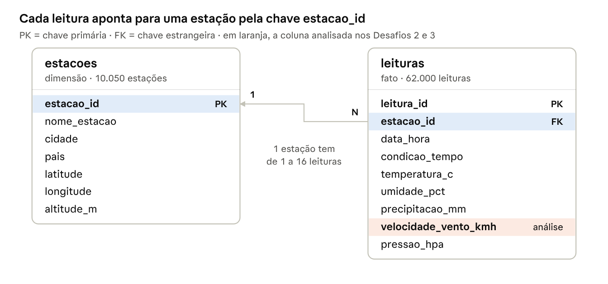
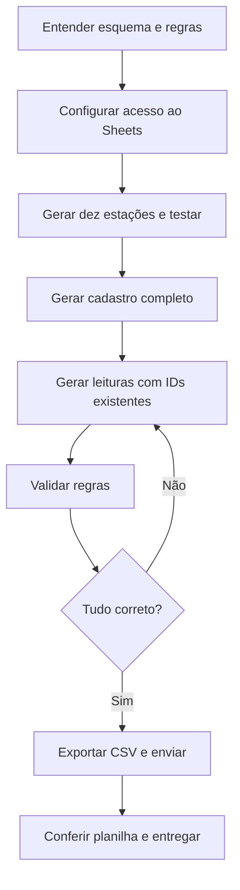
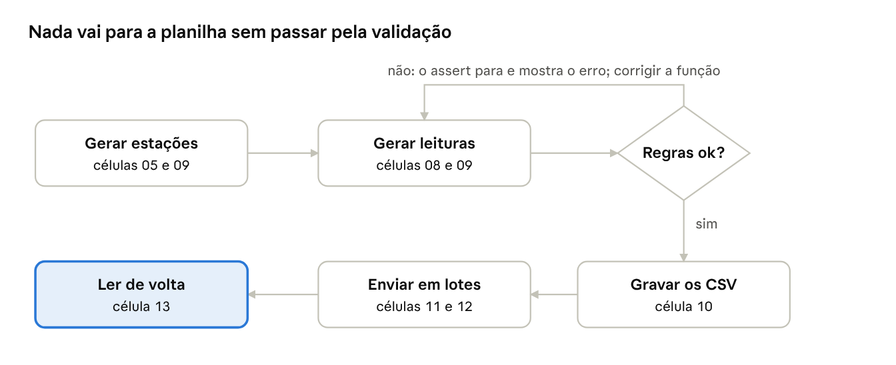

# Guia do Desafio 1 — Serviço Meteorológico
**Construção, geração e integração dos dados | Curso de Analista de Dados**

Este guia acompanha você desde a leitura dos requisitos até a entrega. Você vai construir uma base fictícia, não baixar uma base pronta. Não é necessário dominar Python: os conceitos serão explicados no momento em que forem usados.

## 1. O que precisa ser entregue

Na sessão síncrona, conecte o Colab ao Google Sheets, escreva o cabeçalho e dez estações, e leia os dados de volta. Na etapa assíncrona, gere as duas tabelas completas, valide, exporte os CSV, carregue a planilha e confira a entrega. O roteiro original exige pelo menos 20.000 registros somados. A implementação deste tema escolhe 10.050 estações e 62.000 leituras, totalizando 72.050. Entregue o notebook, os dois CSV e a cópia da planilha com os dados no GitHub; envie o link no Canvas.

## 2. Entenda o negócio antes de programar

Uma rede de estações meteorológicas registra condições do tempo, temperatura, umidade, chuva, vento e pressão. Mais adiante, queremos investigar a partir de qual velocidade um vento se torna incomum na base e em quais condições isso acontece. Neste desafio, porém, ainda não precisamos calcular o limite: precisamos construir dados que permitam essa análise.

Pergunte-se: o que descreve uma estação? O que descreve um evento observado por ela? Uma mesma estação pode ter mais de uma leitura? O país muda a cada leitura? Ao separar cadastro de eventos, evitamos repetir os dados do cadastro e mantemos uma referência confiável.

| estacoes (exemplo ilustrativo) | cidade | pais |
|---|---|---|
| 1 | Faro | Portugal |
| 2 | Tóquio | Japão |

| leituras (exemplo ilustrativo) | estacao_id | vento (km/h) |
|---|---:|---:|
| 1 | 1 | 8 |
| 2 | 1 | 30 |
| 3 | 2 | 12 |

As leituras 1 e 2 pertencem à mesma estação. Se a leitura 3 apontasse para a estação 5, não poderíamos localizar seu cadastro. O identificador único de uma tabela é a chave primária (PK); a referência à chave de outra tabela é a chave estrangeira (FK). Essa ligação é chamada integridade referencial.




*Figura do guia anterior. O intervalo de 1 a 16 leituras por estação e as quantidades representam a base oficial de referência; o número por estação pode variar na geração do Desafio 1.*

O esquema completo é obrigatório:

| Tabela | Coluna | Tipo e finalidade |
|---|---|---|
| estacoes | estacao_id | inteiro, PK |
| estacoes | nome_estacao | texto, código EST-00001 |
| estacoes | cidade | texto, coerente com país |
| estacoes | pais | texto, 15 países |
| estacoes | latitude, longitude | decimais, caixa geográfica aproximada |
| estacoes | altitude_m | inteiro de 0 a 3499 |
| leituras | leitura_id | inteiro, PK, ordem cronológica |
| leituras | estacao_id | inteiro, FK |
| leituras | data_hora | data e hora |
| leituras | condicao_tempo | texto, quatro condições |
| leituras | temperatura_c | decimal, °C |
| leituras | umidade_pct | decimal, 20 a 100% |
| leituras | precipitacao_mm | decimal, milímetros |
| leituras | velocidade_vento_kmh | decimal, km/h |
| leituras | pressao_hpa | decimal, hPa |

## 3. Transforme as regras em um plano

A documentação não pede valores independentes. O país determina as opções de cidade e coordenadas; a condição meteorológica determina os parâmetros de vento, umidade, chuva, temperatura e pressão. A altitude e a latitude também influenciam parte das medidas. Portanto, a ordem de geração importa.

| Países | Peso de cada país |
|---|---:|
| Brasil | 30% |
| Estados Unidos | 10% |
| Argentina, Canadá, Alemanha, França | 6% |
| Portugal, Japão, Austrália, México | 5% |
| África do Sul, Índia | 4% |
| Reino Unido, Itália | 3% |
| Chile | 2% |

| Condição | Probabilidade | Umidade média | Vento médio | Chuva |
|---|---:|---:|---:|---|
| nublado | 50% | 65% | 12 km/h | zero |
| ensolarado | 38% | 45% | 10 km/h | zero |
| chuvoso | 9% | 85% | 14 km/h | positiva |
| tempestade | 3% | 92% | 28 km/h | pelo menos 5 mm |

Esses percentuais são probabilidades de sorteio, não contagens exatas. Uma caixa geográfica é um retângulo aproximado: não garante que a coordenada fique na cidade ou mesmo em terra firme. A simulação abrange janeiro de 2025 a julho de 2026; as leituras não são periódicas. Não apresente os dados como observações reais.



## 4. Prepare o ambiente e a conexão

Crie um repositório público para os desafios conforme o roteiro do curso (projeto_desafios_tecnicos_ad). Abra o [Google Cloud Console](https://console.cloud.google.com/), crie um projeto e ative Google Sheets API e Google Drive API em APIs e serviços > Biblioteca. Em IAM e administração > Contas de serviço, crie uma conta de serviço, sem conceder papéis amplos desnecessários. Abra Chaves > Adicionar chave > Criar nova chave > JSON. Copie o client_email do JSON. Se a organização bloquear chaves, procure o instrutor.

Abra [sheets.new](https://sheets.new/), nomeie a planilha Desafio_01_Meteorologia, compartilhe como Editor com o client_email da conta de serviço e copie o ID que fica entre /d/ e /edit no endereço da planilha. Abra um notebook novo no [Colab](https://colab.research.google.com/). No painel Secrets (ícone de chave), crie GCP_SA_JSON com o conteúdo completo do JSON e GS_ID com o ID da planilha; habilite o acesso do notebook às duas secrets. Não publique a chave, nem em código, nem em saídas. Trabalhe numa planilha dedicada: o código de envio posterior limpa as abas existentes.

Uma API permite que o código solicite operações ao serviço externo. A conta de serviço identifica quem faz o pedido, mas só consegue editar a planilha quando ela é compartilhada. O gspread encapsula essas chamadas. Não confunda o Colab com Apps Script.

### Célula 01 — Instalar bibliotecas

```python
!pip install -q gspread faker
```

O comando instala gspread, que manipula planilhas, e Faker, que gera exemplos fictícios. O Colab já disponibiliza pandas. Execute as células de cima para baixo; se reiniciar o ambiente, as variáveis desaparecem.

### Célula 02 — Autenticar

```python
# Bibliotecas usadas ao longo do notebook.
import json, gspread, random, os, time, math
from faker import Faker
import pandas as pd

# date, datetime e timedelta são usados para criar e somar datas.
from datetime import date, datetime, timedelta

from google.colab import files
# O userdata dá acesso às Secrets do Colab (credencial e ID da planilha).
from google.colab import userdata

# Lê o conteúdo do JSON da credencial (Secret GCP_SA_JSON) e converte o texto em dicionário.
info = json.loads(userdata.get("GCP_SA_JSON"))

# Cria o cliente do gspread autenticado com a service account.
gc = gspread.service_account_from_dict(info)

# Exibe o e-mail da credencial para confirmar que a autenticação funcionou.
print("Conectado como:", info["client_email"])
```

userdata.get lê a secret, json.loads converte seu texto em uma estrutura de dados e service_account_from_dict cria o cliente autenticado. A mensagem com o e-mail identifica a conta; ainda não prova que ela tem acesso à planilha. Não imprima o JSON.

### Célula 03 — Abrir a planilha

```python
# Lê o ID da planilha guardado na Secret GS_ID.
SHEET_ID = userdata.get("GS_ID")

# Nome da tabela dimensão do tema: será o nome da primeira aba da planilha.
NOME_TABELA = "estacoes"

# Abre a planilha pelo ID e seleciona a primeira aba (ws será usada nas próximas células).
sh = gc.open_by_key(SHEET_ID)
ws = sh.sheet1

# Renomeia a aba com o nome da tabela e exibe os dados da planilha.
ws.update_title(NOME_TABELA)
print(sh.title, "|", ws.title, "|", sh.url)
```

O ID identifica o arquivo, enquanto ws aponta para uma aba. Confira se o título corresponde ao seu arquivo e se a aba foi renomeada para estacoes. Erro 403 ou SpreadsheetNotFound: confira as APIs, o ID e o compartilhamento com a conta de serviço.

## 5. Teste o esquema e gere dez estações

### Célula 04 — Escrever cabeçalho

```python
# Nomes EXATOS das colunas da tabela dimensão, na mesma ordem da documentação do tema.
COLUNAS_DIMENSAO = ["estacao_id", "nome_estacao", "cidade", "pais",
                    "latitude", "longitude", "altitude_m"]

# Escreve o cabeçalho a partir da célula A1.
ws.update(range_name="A1", values=[COLUNAS_DIMENSAO])

# Lê a linha 1 de volta e compara com COLUNAS_DIMENSAO.
print("Cabeçalho confere:", ws.row_values(1) == COLUNAS_DIMENSAO)
```

A lista determina a ordem dos valores. values espera uma lista de linhas; por isso envolvemos o cabeçalho em outra lista. Esperamos True. Utilize uma aba vazia no primeiro teste.

### Célula 05 — Construir o cadastro

Antes de sortear uma estação, precisamos definir seus dados dependentes. Se Portugal for selecionado, a cidade deve vir das opções portuguesas e as coordenadas da caixa de Portugal. Para cada registro, queremos um ID diferente. A função recebe i e devolve um dicionário, isto é, os nomes das colunas associados aos respectivos valores.

Uma função de sorteio comum daria as mesmas chances a todos os países. random.choices recebe pesos: [30,10,...] distribui as probabilidades conforme a documentação. Como retorna uma lista, [0] seleciona o resultado. CAIXA_PAIS[pais] busca os quatro limites da caixa; random.uniform sorteia entre os limites. O Faker inventa cidades brasileiras. A semente fixa ajuda a repetir os sorteios no mesmo ambiente. O formato EST-{i:05d} acrescenta zeros à esquerda do identificador.

```python
# Gerador do Faker em português do Brasil (usado nas cidades brasileiras e nas datas).
fake = Faker("pt_BR")

# Sementes fixas: a cada execução os valores aleatórios saem iguais (resultado reproduzível).
Faker.seed(42)
random.seed(42)

# Países e pesos definidos na documentação do tema (a soma dá 100).
PAISES = ["Brasil", "Estados Unidos", "Argentina", "Canadá", "Alemanha", "França",
          "Portugal", "Japão", "Austrália", "México", "África do Sul", "Índia",
          "Reino Unido", "Itália", "Chile"]
PESOS_PAISES = [30, 10, 6, 6, 6, 6, 5, 5, 5, 5, 4, 4, 3, 3, 2]

# Caixa geográfica aproximada de cada país: (latitude mínima, latitude máxima, longitude mínima, longitude máxima).
CAIXA_PAIS = {
    "Brasil":         (-33.0,   5.0, -73.0, -35.0),
    "Estados Unidos": ( 25.0,  49.0, -124.0, -67.0),
    "Argentina":      (-55.0, -22.0, -73.0, -54.0),
    "Canadá":         ( 42.0,  70.0, -140.0, -53.0),
    "Alemanha":       ( 47.3,  55.0,   6.0,  15.0),
    "França":         ( 42.5,  51.0,  -4.5,   8.0),
    "Portugal":       ( 37.0,  42.0,  -9.5,  -6.2),
    "Japão":          ( 31.0,  45.0, 129.0, 145.0),
    "Austrália":      (-39.0, -11.0, 113.0, 153.0),
    "México":         ( 15.0,  32.0, -117.0, -87.0),
    "África do Sul":  (-34.8, -22.0,  16.5,  32.9),
    "Índia":          (  8.0,  35.0,  68.0,  97.0),
    "Reino Unido":    ( 50.0,  58.6,  -8.0,   1.8),
    "Itália":         ( 37.0,  47.0,   6.6,  18.5),
    "Chile":          (-55.0, -17.5, -75.6, -67.0),
}

# Lista de 5 cidades por país (o Brasil usa nomes gerados pelo Faker).
CIDADES_PAIS = {
    "Estados Unidos": ["Nova York", "Chicago", "Denver", "Seattle", "Miami"],
    "Argentina":      ["Buenos Aires", "Córdoba", "Rosário", "Mendoza", "Salta"],
    "Canadá":         ["Toronto", "Montreal", "Vancouver", "Calgary", "Ottawa"],
    "Alemanha":       ["Berlim", "Munique", "Hamburgo", "Colônia", "Frankfurt"],
    "França":         ["Paris", "Lyon", "Marselha", "Toulouse", "Bordéus"],
    "Portugal":       ["Lisboa", "Porto", "Coimbra", "Braga", "Faro"],
    "Japão":          ["Tóquio", "Osaka", "Sapporo", "Fukuoka", "Nagoya"],
    "Austrália":      ["Sydney", "Melbourne", "Brisbane", "Perth", "Adelaide"],
    "México":         ["Cidade do México", "Guadalajara", "Monterrey", "Puebla", "Mérida"],
    "África do Sul":  ["Joanesburgo", "Cidade do Cabo", "Durban", "Pretória", "Porto Elizabeth"],
    "Índia":          ["Nova Délhi", "Mumbai", "Bangalore", "Chennai", "Calcutá"],
    "Reino Unido":    ["Londres", "Manchester", "Edimburgo", "Birmingham", "Glasgow"],
    "Itália":         ["Roma", "Milão", "Nápoles", "Turim", "Florença"],
    "Chile":          ["Santiago", "Valparaíso", "Concepción", "Antofagasta", "Punta Arenas"],
}

def gerar_linha(i):
    # Devolve UM registro fictício de estação, no formato {nome_da_coluna: valor}.
    # "i" é o número da linha e serve de identificador sequencial.

    # Coluna de origem: o país é sorteado primeiro e define cidade e coordenadas.
    pais = random.choices(PAISES, weights=PESOS_PAISES)[0]
    lat_min, lat_max, lon_min, lon_max = CAIXA_PAIS[pais]
    cidade = fake.city() if pais == "Brasil" else random.choice(CIDADES_PAIS[pais])

    return {
        "estacao_id": i,                                           # identificador sequencial (PK)
        "nome_estacao": f"EST-{i:05d}",                            # código no formato EST-00001
        "cidade": cidade,                                          # cidade coerente com o país
        "pais": pais,                                              # país sorteado com os pesos da documentação
        "latitude": round(random.uniform(lat_min, lat_max), 4),    # dentro da caixa do país
        "longitude": round(random.uniform(lon_min, lon_max), 4),   # dentro da caixa do país
        "altitude_m": random.randint(0, 3499),                     # altitude em metros (0 a 3.499)
    }

# Gera 10 registros de teste.
linhas = [gerar_linha(i) for i in range(1, 11)]
print(linhas[0])

# Converte cada registro em lista de valores NA ORDEM do cabeçalho e envia para a planilha.
valores = [[linha[c] for c in COLUNAS_DIMENSAO] for linha in linhas]
ws.append_rows(valores, value_input_option="RAW")
print(len(valores), "linhas enviadas")
```

O laço embutido em linhas chama a função dez vezes. O próximo passo transforma cada dicionário em uma lista na mesma ordem do cabeçalho; append_rows acrescenta as linhas. RAW evita reinterpretar os valores. Se repetir essa célula, haverá registros adicionais: limpe a aba de teste e reescreva o cabeçalho antes de repetir.

### Célula 06 — Conferir o que chegou

```python
# Lê de volta tudo o que está na aba para conferir o que realmente chegou à planilha.
valores_lidos = ws.get_all_values()

print("Linhas (cabeçalho + dados):", len(valores_lidos))    # esperado: 11
print("Cabeçalho confere:", valores_lidos[0] == COLUNAS_DIMENSAO)
print(valores_lidos[:3])
```

Espere 11 linhas (um cabeçalho e dez estações), cabeçalho igual e registros coerentes. Abra a planilha para conferir. Se houver 21 linhas, provavelmente o envio de teste ocorreu duas vezes. Corrija agora, não durante a análise.

## 6. Construa a tabela de leituras

### Célula 07 — Definir o esquema

```python
# Nome da tabela fato do tema: será o nome da segunda aba da planilha.
NOME_TABELA_FATO = "leituras"

# Nomes EXATOS das colunas da tabela fato, na mesma ordem da documentação do tema.
COLUNAS_FATO = ["leitura_id", "estacao_id", "data_hora", "condicao_tempo",
                "temperatura_c", "umidade_pct", "precipitacao_mm",
                "velocidade_vento_kmh", "pressao_hpa"]

# Coluna da tabela fato que é a chave estrangeira (guarda o ID da tabela dimensão).
COLUNA_FK = "estacao_id"

# Confere se a chave estrangeira é mesmo uma das colunas da tabela fato.
assert COLUNA_FK in COLUNAS_FATO, "COLUNA_FK precisa ser um dos nomes de COLUNAS_FATO"
print(NOME_TABELA_FATO, "|", COLUNAS_FATO)
```

O assert interrompe o programa quando sua condição não é verdadeira. Agora o esquema declara qual campo conecta a leitura ao cadastro.

### Célula 08 — Gerar uma leitura

Imagine três estações com IDs 1, 2 e 3. Se sorteássemos quatro leituras livremente, poderíamos obter 1, 1, 1, 3, deixando a estação 2 sem leitura. Por isso as primeiras leituras percorrem a lista de IDs, e só as demais são sorteadas. Precisamos também consultar latitude e altitude do cadastro, sem sorteá-las novamente.

A condição do tempo é escolhida antes das medidas. AJUSTE_CONDICAO guarda, na ordem, ajuste de temperatura, média e desvio de umidade, escala do vento e ajuste de pressão. A distribuição gama produz muitos ventos baixos e poucos altos; com forma 2, escala 14 gera média teórica 28. A distribuição normal varia em torno de uma média; a exponencial produz muitas chuvas pequenas e poucas grandes. Não é necessário derivar essas distribuições: elas traduzem as regras de simulação fornecidas. A função limita a umidade entre 20 e 100, calcula a temperatura com sazonalidade invertida por hemisfério e efeito diário, e reduz a pressão à medida que a altitude aumenta.

```python
# Condições do tempo e pesos definidos na documentação do tema.
CONDICOES = ["nublado", "ensolarado", "chuvoso", "tempestade"]
PESOS_CONDICOES = [50, 38, 9, 3]

# Efeito de cada condição sobre as demais variáveis (tabela acima).
AJUSTE_CONDICAO = {
    #             temperatura, umidade média, umidade desvio, escala do vento, pressão
    "ensolarado": (+1.5, 45, 12,  5, +1),
    "nublado":    ( 0.0, 65, 12,  6,  0),
    "chuvoso":    (-2.0, 85,  7,  7, -3),
    "tempestade": (-4.0, 92,  5, 14, -8),
}

# Período simulado das leituras: 01/01/2025 a 31/07/2026.
INICIO_LEITURAS = datetime(2025, 1, 1)
FIM_LEITURAS = datetime(2026, 7, 31, 23, 59, 59)

def gerar_linha_fato(i, ids_dim, info_dim):
    # Devolve UMA leitura fictícia, no formato {nome_da_coluna: valor}.
    # "i" é o número da linha; "ids_dim" é a lista de IDs que existem na tabela dimensão;
    # "info_dim" guarda (latitude, altitude_m) de cada estação.

    # --- Chave estrangeira: primeiro uma leitura para cada estação, depois sorteio ---
    estacao_id = ids_dim[i - 1] if i <= len(ids_dim) else random.choice(ids_dim)
    latitude, altitude = info_dim[estacao_id]

    # --- Valores de origem: o momento da leitura e a condição do tempo ---
    momento = fake.date_time_between(start_date=INICIO_LEITURAS, end_date=FIM_LEITURAS)
    condicao = random.choices(CONDICOES, weights=PESOS_CONDICOES)[0]
    aj_temp, umid_media, umid_desvio, escala_vento, aj_pressao = AJUSTE_CONDICAO[condicao]

    # --- Temperatura: latitude, altitude, época do ano, hora do dia e condição ---
    dia_do_ano = momento.timetuple().tm_yday
    sazonal = 6 * math.cos(2 * math.pi * (dia_do_ano - 196) / 365.25)   # pico em meados de julho no hemisfério norte
    if latitude < 0:
        sazonal = -sazonal                                              # estações invertidas no hemisfério sul
    hora = momento.hour + momento.minute / 60
    diaria = 5 * math.cos(2 * math.pi * (hora - 15) / 24)               # máxima por volta das 15 h
    temperatura = (25 - abs(latitude) / 3 - 0.0065 * altitude
                   + sazonal + diaria + aj_temp + random.gauss(0, 2))

    # --- Umidade, vento e pressão dependem da condição ---
    umidade = min(100.0, max(20.0, random.gauss(umid_media, umid_desvio)))
    vento = random.gammavariate(2, escala_vento)
    pressao = random.gauss(1013, 8) - 0.10 * altitude + aj_pressao

    # --- Chuva: só existe em leituras chuvoso e tempestade ---
    if condicao == "chuvoso":
        chuva = max(0.1, round(random.expovariate(1 / 4), 1))
    elif condicao == "tempestade":
        chuva = round(5 + random.expovariate(1 / 7), 1)
    else:
        chuva = 0.0

    return {
        "leitura_id": i,                                        # identificador (renumerado em ordem cronológica na Célula 09)
        "estacao_id": estacao_id,                               # CHAVE ESTRANGEIRA: um ID que existe na dimensão
        "data_hora": momento.strftime("%Y-%m-%d %H:%M:%S"),     # data e hora da leitura
        "condicao_tempo": condicao,                             # ensolarado, nublado, chuvoso ou tempestade
        "temperatura_c": round(temperatura, 1),                 # graus Celsius
        "umidade_pct": round(umidade, 1),                       # % entre 20 e 100
        "precipitacao_mm": chuva,                               # milímetros (0 quando não chove)
        "velocidade_vento_kmh": round(vento, 1),                # km/h
        "pressao_hpa": round(pressao, 1),                       # hPa
    }

# Teste com as 10 estações de teste da Célula 05.
info_teste = {l["estacao_id"]: (l["latitude"], l["altitude_m"]) for l in linhas}
print(gerar_linha_fato(1, list(info_teste), info_teste))
```

Observe a ordem: estação → localização e data → condição → medidas. O return reúne o registro completo. No teste, confira se o ID existe, se o vento não é negativo e se chuva é zero em tempo seco ou positiva em chuva/tempestade.

## 7. Gere a base completa

Agora que o cadastro e o evento funcionam isoladamente, podemos escalá-los. Precisamos organizar milhares de dicionários como tabelas. O DataFrame do pandas representa uma tabela com colunas e linhas. Para a leitura consultar a estação rapidamente, extraímos a lista de IDs e montamos um dicionário que associa cada ID a latitude e altitude.

### Célula 09 — Gerar as tabelas

```python
# Quantidade de linhas de cada tabela (volumetria da documentação). O total precisa ser de pelo menos 20.000.
N_DIM = 10_050
N_FATO = 62_000

# Reinicia as sementes: o resultado fica reproduzível.
Faker.seed(42)
random.seed(42)

# ---- Tabela dimensão: usa a função gerar_linha (Célula 05) ----
tabela_dim = pd.DataFrame([gerar_linha(i) for i in range(1, N_DIM + 1)], columns=COLUNAS_DIMENSAO)

# ---- Tabela fato: usa a função gerar_linha_fato (Célula 08) ----
# ids_dim é a lista de IDs da dimensão GERADA acima: é nela que a fato busca a chave estrangeira.
ids_dim = list(tabela_dim[COLUNAS_DIMENSAO[0]])
info_dim = dict(zip(tabela_dim["estacao_id"], zip(tabela_dim["latitude"], tabela_dim["altitude_m"])))
tabela_fato = pd.DataFrame([gerar_linha_fato(i, ids_dim, info_dim) for i in range(1, N_FATO + 1)], columns=COLUNAS_FATO)

# Ordena as leituras pelo momento e renumera o leitura_id (1, 2, 3...) em ordem cronológica.
tabela_fato = tabela_fato.sort_values("data_hora", kind="stable").reset_index(drop=True)
tabela_fato["leitura_id"] = range(1, len(tabela_fato) + 1)

# Guarda as tabelas usando o nome de cada uma.
BASES_GERADAS = {NOME_TABELA: tabela_dim, NOME_TABELA_FATO: tabela_fato}

print({nome: len(df) for nome, df in BASES_GERADAS.items()}, "| total:", len(tabela_dim) + len(tabela_fato))
display(tabela_dim.head())
display(tabela_fato.head())
```

As sementes são reiniciadas antes da geração definitiva. O zip combina valores na mesma ordem. A dimensão é criada primeiro; o segundo DataFrame recebe informações dela. A ordenação usa a data no formato ano-mês-dia, que permite ordem cronológica; depois renumeramos leitura_id. Esperamos 10.050 e 62.000 linhas, sete e nove colunas respectivamente.




*Figura do guia anterior: a validação precisa acontecer antes da exportação e do envio. A etapa de leitura de volta deve verificar os dados efetivamente gravados, conforme o complemento da célula 13.*

## 8. Valide antes de exportar

É preciso provar que as regras foram atendidas por verificações, não apenas pela ausência de exceções. Compare nomes e ordem das colunas, unicidade dos IDs, vínculo entre as tabelas, presença de leituras para cada estação, datas e regras meteorológicas. isin verifica se cada valor pertence a um conjunto; all exige que todas as verificações sejam verdadeiras.

### Célula 10 — Validar e gravar os CSV

```python
# ---- Regras do guia ----
assert list(tabela_dim.columns) == COLUNAS_DIMENSAO, "Colunas diferentes do esquema na tabela dimensão"
assert list(tabela_fato.columns) == COLUNAS_FATO, "Colunas diferentes do esquema na tabela fato"
assert tabela_dim[COLUNAS_DIMENSAO[0]].is_unique, "ID repetido na tabela dimensão"
assert tabela_fato["leitura_id"].is_unique, "ID repetido na tabela fato"
assert tabela_fato[COLUNA_FK].isin(tabela_dim[COLUNAS_DIMENSAO[0]]).all(), "Chave estrangeira sem ID na dimensão"
assert len(tabela_dim) + len(tabela_fato) >= 20_000, "Abaixo do mínimo (20.000 linhas somadas)."

# ---- Regras da documentação do tema ----
assert tabela_dim["estacao_id"].isin(tabela_fato["estacao_id"]).all(), "Há estação sem nenhuma leitura"
assert tabela_fato["data_hora"].is_monotonic_increasing, "Leituras fora de ordem cronológica"
lat_brasil = tabela_dim.loc[tabela_dim["pais"] == "Brasil", "latitude"]
assert lat_brasil.between(-33, 5).all(), "Latitude do Brasil fora da faixa (-33 a 5)"
assert tabela_fato["umidade_pct"].between(0, 100).all(), "Umidade fora da faixa (0 a 100)"
assert set(tabela_fato["condicao_tempo"]) <= set(CONDICOES), "Condição do tempo fora dos 4 valores válidos"
com_chuva = tabela_fato["condicao_tempo"].isin(["chuvoso", "tempestade"])
assert (tabela_fato.loc[com_chuva, "precipitacao_mm"] > 0).all(), "Leitura chuvosa ou de tempestade sem chuva"
assert (tabela_fato.loc[~com_chuva, "precipitacao_mm"] == 0).all(), "Chuva em leitura ensolarada ou nublada"
medias = tabela_fato.groupby("condicao_tempo")[["pressao_hpa", "umidade_pct", "velocidade_vento_kmh"]].mean()
assert medias.loc["tempestade", "pressao_hpa"] < medias.loc["ensolarado", "pressao_hpa"], "Tempestade deveria ter pressão menor"
assert medias.loc["tempestade", "umidade_pct"] > medias.loc["ensolarado", "umidade_pct"], "Tempestade deveria ter umidade maior"
assert medias.loc["tempestade", "velocidade_vento_kmh"] > medias.loc["ensolarado", "velocidade_vento_kmh"], "Tempestade deveria ter vento maior"
print("Todas as validações passaram.")
display(medias.round(1))

# ---- Grava um CSV por tabela, lê de volta para conferir e baixa o arquivo ----
os.makedirs("bases_geradas", exist_ok=True)
for nome, df in BASES_GERADAS.items():
    caminho = f"bases_geradas/{nome}.csv"
    df.to_csv(caminho, index=False, encoding="utf-8")
    lido = pd.read_csv(caminho)
    assert len(lido) == len(df) and list(lido.columns) == list(df.columns), f"CSV diferente em {nome}"
    print(nome + ".csv ->", len(lido), "linhas")
    files.download(caminho)
```

**Ajuste recomendado em relação ao notebook original:** sua verificação de umidade aceita 0 a 100%, mas o esquema do tema e o gerador definem 20 a 100%. Substitua a linha de validação por:
```python
assert tabela_fato["umidade_pct"].between(20, 100).all(), "Umidade fora de 20 a 100"
```
Acrescente verificações de altitude, ausência de nulos e vento não negativo antes de exportar:
```python
assert tabela_dim["altitude_m"].between(0, 3499).all()
assert not tabela_dim.isna().any().any()
assert not tabela_fato.isna().any().any()
assert tabela_fato["velocidade_vento_kmh"].ge(0).all()
```
Não corrija uma leitura errada manualmente na planilha; investigue a função que a gerou. A comparação da pressão por condição é um teste geral do gerador, mas a altitude domina essa medida; ela não demonstra causalidade. O código exporta sem o índice do pandas, relê cada arquivo e baixa uma cópia. Guarde ambos os CSV gerados para a entrega.

## 9. Envie ao Google Sheets

Uma chamada por registro seria lenta e poderia atingir limites da API. Vamos enviar listas de até 5.000 registros, com pausa de dois segundos. Isso reduz as requisições, mas não garante que a quota nunca seja atingida.

### Célula 11 — Definir a função de envio

```python
def enviar(sh, df, nome_aba, lote=5000, pausa=2):
    # Formata o número com ponto como separador de milhar (ex.: 62.000).
    n = lambda x: f"{x:,}".replace(",", ".")

    # Reaproveita a aba se ela já existir (limpando o conteúdo) ou cria uma nova.
    try:
        aba = sh.worksheet(nome_aba)
        aba.clear()
    except gspread.WorksheetNotFound:
        aba = sh.add_worksheet(title=nome_aba, rows=len(df) + 1, cols=len(df.columns))

    # Ajusta o tamanho da aba e grava o cabeçalho na linha 1.
    aba.resize(rows=len(df) + 1, cols=len(df.columns))
    aba.update(range_name="A1", values=[list(df.columns)])

    # Converte a tabela em lista de linhas (valor ausente vira texto vazio).
    valores = df.astype(object).where(df.notna(), "").values.tolist()

    # Envia em lotes, com pausa para respeitar o limite de escritas por minuto.
    for i in range(0, len(valores), lote):
        aba.append_rows(valores[i:i + lote], value_input_option="RAW")
        print(f"  {nome_aba}: {n(min(i + lote, len(valores)))} / {n(len(valores))}")
        time.sleep(pausa)

    # Lê de volta e confere a quantidade de linhas (sem contar o cabeçalho).
    lidas = len(aba.col_values(1)) - 1
    if lidas != len(df):
        raise RuntimeError(f"Aba {nome_aba}: enviei {len(df)}, li {lidas}.")
    print(f"OK {nome_aba}: {n(len(df))} linhas na planilha")
```

A função abre a aba ou cria uma nova; se ela já existir, apaga seu conteúdo, redimensiona e escreve o cabeçalho. Depois transforma a tabela em listas, envia fatias e lê a primeira coluna para conferir a quantidade. Execute somente no arquivo destinado ao desafio.

### Célula 12 — Enviar as duas tabelas

```python
# Envia cada tabela gerada para a aba de mesmo nome (dimensão e fato).
for nome, df in BASES_GERADAS.items():
    enviar(sh, df, nome)
```

A função é chamada para estacoes e leituras. Acompanhe as mensagens até a conclusão. Se ocorrer erro 429, aguarde o restabelecimento da quota; reexecute a função na aba afetada, lembrando que ela limpará e reconstruirá essa aba.

### Célula 13 — Conferir a entrega

```python
# Soma e exibe a quantidade total de linhas das tabelas.
total = sum(len(df) for df in BASES_GERADAS.values())
print("Total de linhas:", f"{total:,}".replace(",", "."))
assert total >= 20_000, "Abaixo do mínimo (20.000 linhas somadas)."

# Confere os cabeçalhos e a quantidade de registros em cada aba.
for nome, df in BASES_GERADAS.items():
    w = sh.worksheet(nome)
    assert w.row_values(1) == list(df.columns), f"Cabeçalho diferente em {nome}"
    assert len(w.col_values(1)) - 1 == len(df), f"Contagem diferente em {nome}"

# Confere o relacionamento: toda chave estrangeira da tabela fato existe na tabela dimensão.
fk_fato = BASES_GERADAS[NOME_TABELA_FATO][COLUNA_FK]
ids_dim = BASES_GERADAS[NOME_TABELA][COLUNAS_DIMENSAO[0]]
assert fk_fato.isin(ids_dim).all(), "Há chave estrangeira sem ID correspondente na tabela dimensão"

print("A planilha confere com a base gerada.")
print("Abas da planilha:", [w.title for w in sh.worksheets()])
```

A célula original confere cabeçalhos e quantidades na planilha, mas sua última validação de FK usa os DataFrames locais. Para validar o relacionamento efetivamente gravado, acrescente:
```python
ids_enviados = set(sh.worksheet("estacoes").col_values(1)[1:])
fks_enviadas = sh.worksheet("leituras").col_values(2)[1:]
assert len(ids_enviados) == N_DIM
assert len(fks_enviadas) == N_FATO
assert set(fks_enviadas) <= ids_enviados
assert ids_enviados <= set(fks_enviadas)
```
Os índices 1 e 2 são os números das colunas no Sheets; [1:] ignora o cabeçalho. Abra o arquivo e confira as duas abas e os primeiros registros. Exporte a planilha como .xlsx pelo menu Arquivo > Fazer download > Microsoft Excel.

## 10. Prepare a entrega

Registre o uso de IA nos trechos em que foi utilizada, seguindo o formato do roteiro (AI-Generated-Date, SPDX-SnippetCopyrightText e a licença aplicável). Revise as saídas do notebook: não publique tokens, chaves, JSON ou outros segredos. No GitHub, envie o notebook executado, os CSV gerados e a cópia .xlsx. Entregue o link no Canvas.

- [ ] Notebook executado em ordem, com as duas partes.
- [ ] Teste de dez estações e conferência do cabeçalho registrados.
- [ ] As duas tabelas seguem o esquema do tema; mínimo de 20.000 linhas atendido.
- [ ] Regras de geração e relacionamento verificadas; 72.050 linhas na implementação proposta.
- [ ] CSV exportados e conferidos.
- [ ] Planilha preenchida com uma aba por tabela e validada.
- [ ] Uso de IA registrado e dados identificados como fictícios.
- [ ] Nenhuma credencial publicada; arquivos e link entregues.

## Referências do projeto

- [Roteiro oficial do desafio — parte 1](../desafio_01/README.md), [parte 2](../desafio_01/02.md), [parte 3](../desafio_01/03.md).
- [Esquema e regras do Serviço Meteorológico](../bases_dados/06-servico-meteorologico/06-servico-meteorologico.md).
- [Notebook de referência](../exercicios/Desafio1_API_Python.ipynb).
- [Diretrizes pedagógicas](../docs/DIRETRIZES_APOSTILAS.md).

O código das células foi reproduzido do notebook do projeto; os ajustes de validação foram explicitados. Os dados gerados podem diferir da base oficial dos desafios seguintes. Este guia não pressupõe a leitura de outra apostila.
