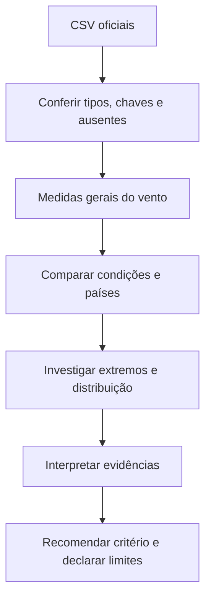
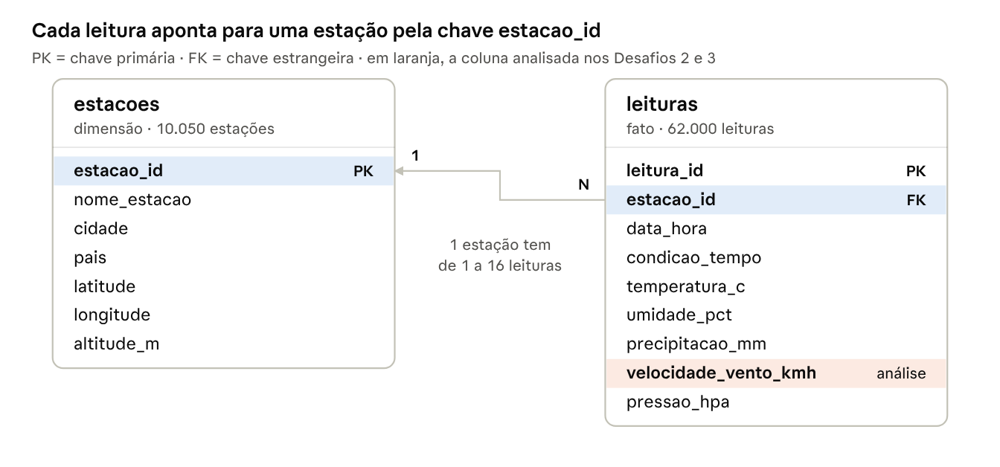
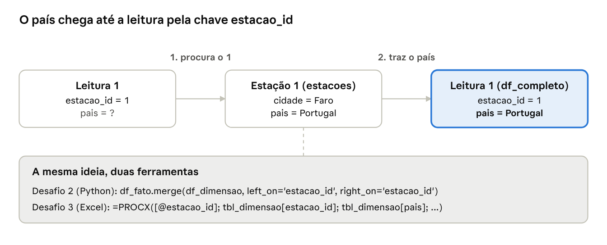
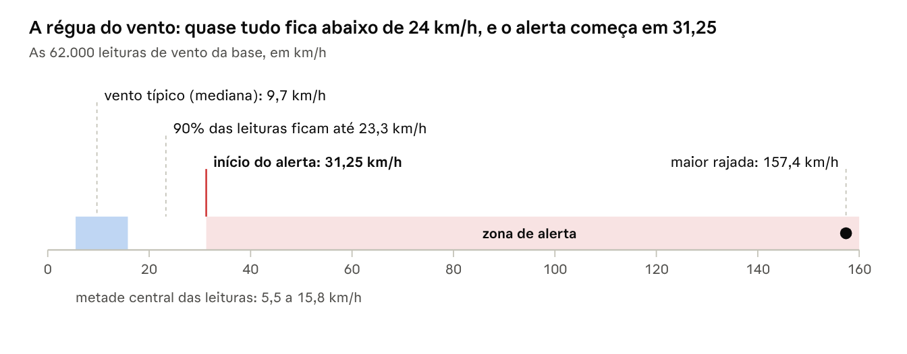
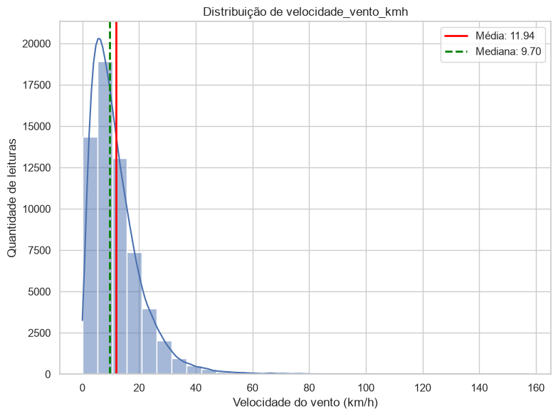
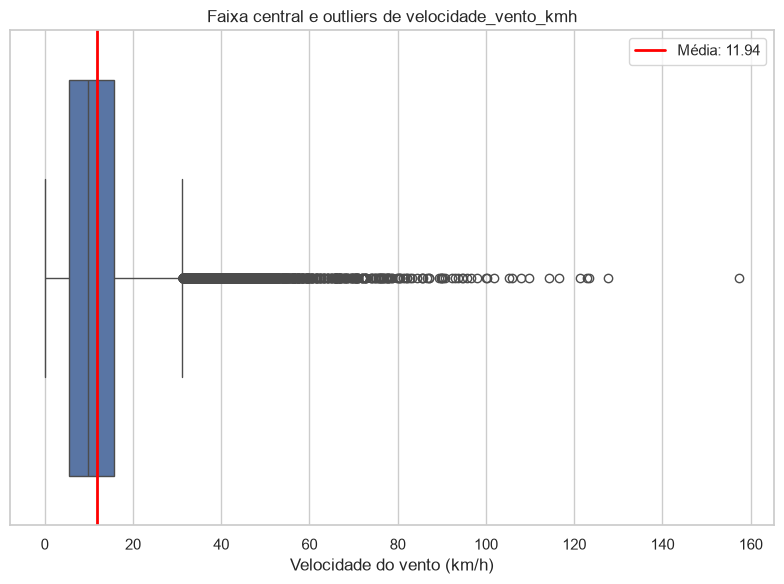
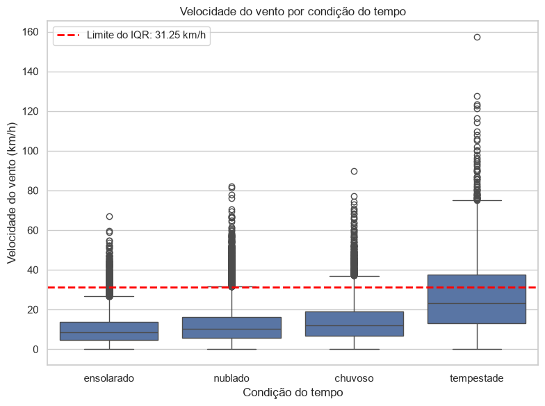

# Guia do Desafio 2 — Serviço Meteorológico
**Análise estatística com Python | Curso de Analista de Dados**

Neste desafio, o trabalho não é gerar dados: é aprender a fazer perguntas sobre uma base existente, produzir evidências e sustentar uma decisão. Não é necessário ter concluído o Desafio 1 para acompanhar este guia.

## 1. Entenda a entrega e a pergunta de negócio

Na sessão síncrona, carregue e confira os dados, calcule pelo menos média, mediana e desvio padrão de uma coluna relevante e escreva uma frase de insight para cada medida, citando o número. Na etapa assíncrona, compare grupos das duas tabelas, investigue ausentes e outliers, leia a distribuição e escreva uma recomendação apoiada em pelo menos duas medidas. Os gráficos são um diferencial do roteiro; o projeto os inclui. Entregue o notebook pelo GitHub e o link pelo Canvas.

A pergunta adotada no projeto é: **a partir de qual velocidade o vento deveria gerar um alerta para a população, e em quais condições meteorológicas ele costuma aparecer?** Os dados são fictícios; a resposta será um critério de monitoramento simulado, não um limite de segurança real.

Antes de escolher um cálculo, identifique a informação necessária. Para um alerta de vento, a medida principal deve ser `velocidade_vento_kmh`. A condição do tempo permite comparar situações e o país permite investigar diferenças geográficas. Uma média geral, sozinha, não informa quais leituras são incomuns. Precisaremos investigar tanto o centro quanto a dispersão e os extremos.

## 2. Conheça os dados e planeje a análise

Baixe **os CSV oficiais do repositório**, não os arquivos gerados no Desafio 1:
- [estacoes.csv](../bases_dados/06-servico-meteorologico/estacoes.csv)
- [leituras.csv](../bases_dados/06-servico-meteorologico/leituras.csv)

A dimensão estacoes descreve 10.050 estações: estacao_id, nome_estacao, cidade, pais, latitude, longitude, altitude_m. A fato leituras registra 62.000 observações: leitura_id, estacao_id, data_hora, condicao_tempo, temperatura_c, umidade_pct, precipitacao_mm, velocidade_vento_kmh e pressao_hpa.

Cada leitura tem seu próprio ID e pertence a uma estação. Uma estação pode ter várias leituras. As observações não têm intervalo regular. As quatro condições são ensolarado, nublado, chuvoso e tempestade.






*Figura do guia anterior. O intervalo de 1 a 16 leituras por estação e as quantidades representam a base oficial de referência; o número por estação pode variar na geração do Desafio 1.*

## 3. Prepare o notebook e carregue os dados

Crie um notebook no Google Colab. Use células de texto para a pergunta, leituras e decisões; use células de código para os cálculos. Execute de cima para baixo. O notebook do projeto está dividido em duas partes.

### Célula 01 — Importações

```python
# ---------- Bibliotecas: ferramentas prontas que o Python usa ----------
import warnings                    # esconde avisos técnicos para não distrair
from pathlib import Path           # manipula caminhos de arquivos e pastas
import shutil                      # manipula arquivos e pastas (ex.: mover, copiar, apagar)

# Estas linhas servem para trabalhar no Google Colab (conectar ao Drive e enviar arquivos)
from google.colab import drive     # conecta o Google Drive ao Colab (para ler e salvar arquivos)
from google.colab import files     # (files) envia arquivos do seu computador para o Colab

# Bibliotecas de análise de dados e de gráficos
import pandas as pd                # tabelas de dados (DataFrame)
import seaborn as sns              # gráficos bonitos e simples
import matplotlib.pyplot as plt    # ajustes nos gráficos (título, linhas...)

# ---------- Configurações gerais (valem para todos os gráficos abaixo) ----------
warnings.filterwarnings("ignore")           # esconde avisos técnicos para não distrair
sns.set_theme(style="whitegrid")            # deixa todos os gráficos com um visual limpo
plt.rcParams["figure.figsize"] = (8, 6)    # tamanho padrão dos gráficos (largura, altura)
```

Pandas organiza tabelas e calcula indicadores; seaborn e matplotlib desenham gráficos; Path representa caminhos; drive e files permitem acessar arquivos no Colab. O notebook silencia avisos globalmente: durante a investigação de problemas, é preferível retirar essa linha para enxergar mensagens úteis.

### Célula 02 — Carregar CSV

```python
# Nomes das tabelas do seu tema (veja a tabela acima), iguais aos nomes dos arquivos CSV.
NOME_TABELA_DIMENSAO = "estacoes"   # ex.: "livros"
NOME_TABELA_FATO = "leituras"           # ex.: "emprestimos"

# ---------- 1) Conectando ao Google Drive ----------
drive.mount("/content/drive")      # vai pedir autorização na primeira vez

# ---------- 2) Dizendo onde os arquivos estão guardados ----------
pasta_dados = Path("/content/drive/MyDrive/Colab Notebooks/desafios/dados")   # pasta onde a base fica guardada no Drive
pasta_dados.mkdir(parents=True, exist_ok=True)                                # cria a pasta "dados" se faltar

# O "/" junta a pasta com o nome do arquivo (o nome vem da variável de cada tabela).
caminho_dimensao = pasta_dados / f"{NOME_TABELA_DIMENSAO}.csv"
caminho_fato = pasta_dados / f"{NOME_TABELA_FATO}.csv"

# ---------- 3) Se faltar algum arquivo, envia os dois de uma vez e o código separa ----------
if not caminho_dimensao.exists() or not caminho_fato.exists():
    print(f"Selecione os arquivos CSV ({NOME_TABELA_DIMENSAO} e {NOME_TABELA_FATO}). Pode escolher os dois de uma vez:")
    enviados = files.upload()                                  # abre o seletor; aceita vários arquivos

    for nome_enviado in enviados:                              # percorre cada arquivo enviado
        if NOME_TABELA_DIMENSAO in nome_enviado.lower():       # o nome contém o da dimensão? salva como dimensão
            shutil.move(nome_enviado, caminho_dimensao)        # salva já com o nome da tabela
            print(f"{nome_enviado} -> {caminho_dimensao.name}")
        elif NOME_TABELA_FATO in nome_enviado.lower():         # o nome contém o da fato? salva como fato
            shutil.move(nome_enviado, caminho_fato)
            print(f"{nome_enviado} -> {caminho_fato.name}")
        else:                                                  # nome que não combina com nenhuma tabela
            print(f"Ignorado: {nome_enviado} (o nome não contém '{NOME_TABELA_DIMENSAO}' nem '{NOME_TABELA_FATO}')")

# Confere se os dois arquivos estão no Drive antes de ler.
for caminho in [caminho_dimensao, caminho_fato]:
    if not caminho.exists():
        raise FileNotFoundError(f"Falta o arquivo {caminho.name}. Execute a célula de novo e envie-o.")

# ---------- 4) Lendo os dois arquivos ----------
df_dimensao = pd.read_csv(caminho_dimensao)
df_fato = pd.read_csv(caminho_fato)

print(NOME_TABELA_DIMENSAO, "->", len(df_dimensao), "linhas")
print(NOME_TABELA_FATO, "->", len(df_fato), "linhas")
```

Autorize o acesso ao Drive e envie os dois arquivos oficiais se solicitado. Se já houver arquivos com os mesmos nomes na pasta, o código os reaproveita: confira a origem antes de executar para não misturar com o Desafio 1. read_csv transforma cada arquivo em DataFrame, uma tabela manipulável pelo Python. Esperamos 10.050 e 62.000 linhas. Se FileNotFoundError aparecer, confira nomes e pasta; se houver apenas uma coluna, verifique o separador do arquivo.

### Células 03 e 04 — Explorar as tabelas

```python
# Quantas linhas (registros do cadastro) e colunas (variáveis) tem a tabela dimensão?
# .shape devolve dois números: (quantidade de linhas, quantidade de colunas)
linhas, colunas = df_dimensao.shape
print(f"A tabela dimensão tem {linhas} linhas e {colunas} colunas (variáveis)")
display(df_dimensao.head())
```


```python
# Quantas linhas (eventos) e colunas (variáveis) tem a tabela fato?
# .shape devolve dois números: (quantidade de linhas, quantidade de colunas)
linhas, colunas = df_fato.shape
print(f"A tabela fato tem {linhas} linhas e {colunas} colunas (variáveis)")
display(df_fato.head())
```

shape retorna dois números, quantidade de linhas e colunas. head mostra os primeiros cinco registros, não toda a base. A dimensão deve ter sete colunas; a fato, nove. Uma leitura com estacao_id 1 pode ser associada à estação 1, mas leitura_id não é o identificador de estação. Examine os campos e as unidades antes de calcular.

## 4. Verifique se os dados permitem responder à pergunta

Imagine que o vento de uma linha seja texto, ou que uma leitura aponte para uma estação inexistente. O cálculo ou a comparação pode ficar incompleto sem que isso seja percebido. Devemos descobrir esses problemas primeiro.

### Células 05 a 08 — Tipos, ausentes, duplicidades e referência

```python
# 1) Tipo de cada coluna e quantidade de valores preenchidos. Compare com o esquema do plano do tema.
df_fato.info()
```


```python
# 2) Valores ausentes por coluna (tabela fato).
print("\nValores ausentes por coluna:")
print(df_fato.isna().sum())
```


```python
# 3) Linhas duplicadas (tabela fato).
print("\nLinhas duplicadas:", df_fato.duplicated().sum())
```


```python
# 4) Chave estrangeira: todos os registros da tabela fato devem apontar para um ID que existe na tabela dimensão.
COLUNA_FK = "estacao_id"        # ex.: "livro_id" (coluna da fato que referencia a dimensão)
COLUNA_ID = "estacao_id"   # ex.: "livro_id" (coluna de ID da dimensão)
print("\nChaves estrangeiras que batem:", df_fato[COLUNA_FK].isin(df_dimensao[COLUNA_ID]).all())
```

info mostra tipos e valores preenchidos. isna produz uma marca para cada campo ausente; sum conta as marcas por coluna. duplicated verifica linhas totalmente iguais. isin verifica se o ID da leitura existe no cadastro e all exige que todos existam.

O resultado salvo do notebook mostra 62.000 velocidades numéricas, nenhum campo ausente na fato, nenhuma linha totalmente duplicada e True para o relacionamento. A data está como texto, aceitável para esta análise sem cálculos temporais.

**Complemento recomendado:** o teste de duplicidade de linha não substitui o teste de chave única. Acrescente:
```python
assert df_dimensao["estacao_id"].notna().all()
assert df_dimensao["estacao_id"].is_unique
assert df_fato["leitura_id"].notna().all()
assert df_fato["leitura_id"].is_unique
assert df_fato["estacao_id"].notna().all()
assert df_fato["velocidade_vento_kmh"].ge(0).all()
```
Se a chave não for única, investigue antes da junção. Não apague registros sem saber por que estão repetidos. Registre em uma célula de texto o que a conferência mostrou.

## 5. Entenda o vento típico e sua variação

### Célula 09 — Escolher a coluna

```python
# Coluna numérica escolhida no Passo 1 (nome EXATO, como está no esquema do tema).
COLUNA_NUMERICA = "velocidade_vento_kmh"

# A coluna escolhida, como uma série (uma coluna do DataFrame).
serie_numerica = df_fato[COLUNA_NUMERICA]
print("Valores preenchidos:", serie_numerica.count(), "| ausentes:", serie_numerica.isna().sum())
```

Selecionar uma coluna de um DataFrame produz uma Series, uma sequência de valores. A variável serie_numerica será usada nas próximas etapas. Conte valores preenchidos e ausentes; se a coluna não for numérica, volte à importação. Esperamos 62.000 valores e zero ausentes.

Antes de calcular na base inteira, considere cinco leituras fictícias, em km/h: 4, 6, 6, 10 e 34. O objetivo do exemplo é entender o que cada medida revela.

| Medida | Como calcular no exemplo | Resultado |
|---|---|---:|
| Média | (4+6+6+10+34)/5 | 12 |
| Mediana | Ordenar e localizar o valor central | 6 |
| Moda | Valor mais frequente | 6 |
| Mínimo / máximo | Menor e maior valor | 4 / 34 |
| Amplitude | 34 − 4 | 30 |

Se retirássemos 34 apenas para demonstrar seu efeito, a média cairia para 6,5, mas a mediana permaneceria 6. A mediana é mais resistente a extremos. Isso não significa que 34 seja um erro.

O desvio padrão quantifica a dispersão em torno da média. Subtraímos 12 de cada valor, elevamos as diferenças ao quadrado, somamos 64 + 36 + 36 + 4 + 484 = 624 e dividimos por n−1 (4) para obter a variância amostral 156; a raiz quadrada é aproximadamente 12,49 km/h. O pandas usa essa convenção amostral por padrão. A variância fica em (km/h)², enquanto o desvio padrão tem a unidade original. Não interprete o desvio como limite máximo nem como distância exata de cada leitura.

### Célula 10 — Automatizar os cálculos

```python
# Medidas de Tendência central e dispersão.
medidas = pd.Series({
    "Média": serie_numerica.mean(),
    "Mediana": serie_numerica.median(),
    "Moda": serie_numerica.mode()[0],            # se houver empate, a primeira será selecionada
    "Desvio padrão": serie_numerica.std(),
    "Variância": serie_numerica.var(),
    "Mínimo": serie_numerica.min(),
    "Máximo": serie_numerica.max(),
    "Amplitude": serie_numerica.max() - serie_numerica.min(),
}).round(2)
display(medidas)

# Média muito diferente da mediana é sinal de valores extremos ou de dados assimétricos.
print("Média - mediana:", round(medidas["Média"] - medidas["Mediana"], 2))
```

Cada método calcula uma medida sobre a mesma série. mode pode retornar mais de uma moda; o notebook seleciona a primeira. round arredonda a exibição; use os valores originais para critérios e comparações.

Resultados registrados na execução do projeto:

| Medida | Resultado |
|---|---:|
| Média | 11,94 km/h |
| Mediana | 9,70 km/h |
| Moda selecionada | 6,00 km/h |
| Desvio padrão amostral | 9,25 km/h |
| Variância amostral | 85,57 (km/h)² |
| Mínimo | 0 |
| Máximo | 157,40 km/h |
| Amplitude | 157,40 km/h |

O que podemos concluir? A média é 2,24 km/h maior que a mediana, sugerindo assimetria à direita; vamos verificar isso na distribuição. A mediana diz que pelo menos metade das observações está em 9,70 km/h ou abaixo. O desvio padrão de 9,25 indica dispersão considerável em relação à média. Não se conclui que uma velocidade é segura somente por estar perto da média.

Escreva três insights no notebook, um para cada medida obrigatória. Uma estrutura útil é número → significado → consequência para a análise. Por exemplo: “A mediana foi 9,70 km/h; metade das leituras não supera esse valor. Ela ajuda a descrever o centro da base, mas não define sozinha um alerta.” Mostre ao instrutor pelo menos uma medida e seu insight.

## 6. Compare os grupos

Uma média geral mistura condições diferentes. Imagine duas leituras de sol (8 e 10) e duas de tempestade (30 e 40). A média de sol é 9 e a de tempestade, 35 km/h. A média geral não revela essa diferença. Agrupar significa separar observações por categoria e aplicar um cálculo a cada grupo.




*Figura do guia anterior: o merge no Python e a busca no Excel usam a mesma chave para associar a informação do cadastro ao evento.*

### Célula 11 — Juntar cadastro e eventos

Para comparar por país, o campo pais está em estacoes, enquanto vento está em leituras. Precisamos trazer o cadastro para cada evento.

| leitura_id | estacao_id | vento | país após a junção |
|---|---:|---:|---|
| 1 | 1 | 8 | Portugal |
| 2 | 1 | 30 | Portugal |
| 3 | 2 | 12 | Japão |

Dados ilustrativos. A estação 1 deve corresponder a uma única linha do cadastro; caso contrário, a junção pode multiplicar registros.


```python
# Junta a fato com a dimensão: cada registro da fato recebe as colunas do seu cadastro.
df_completo = df_fato.merge(df_dimensao, left_on=COLUNA_FK, right_on=COLUNA_ID, how="left", suffixes=("", "_dim"))

print("Linhas da fato:", len(df_fato), "| depois da junção:", len(df_completo))   # precisam ser iguais
df_completo.head()
```

merge realiza a junção. how="left" conserva todas as leituras, mesmo sem correspondência. left_on e right_on indicam as chaves. Esperamos 62.000 linhas antes e depois. Recomenda-se adicionar validate="many_to_one" à chamada e conferir df_completo["pais"].isna().sum(); deve dar zero. Isso evita duplicações e identifica registros sem cadastro.

### Célula 12 — Comparar condições

```python
# Coluna categórica usada para comparar (da fato). Poucos valores diferentes funcionam melhor.
COLUNA_GRUPO = "condicao_tempo"

# Quantidade, média, mediana e desvio padrão de cada grupo, do maior para o menor valor médio.
por_grupo = df_completo.groupby(COLUNA_GRUPO)[COLUNA_NUMERICA].agg(["count", "mean", "median", "std"]).round(2)
por_grupo = por_grupo.sort_values("mean", ascending=False)
display(por_grupo)
```

Leia a expressão por partes: groupby separa por condição; [COLUNA_NUMERICA] escolhe vento; agg aplica contagem, média, mediana e desvio padrão; sort_values ordena pela média. count conta valores não ausentes.

| Condição | Leituras | Média | Mediana | Desvio padrão |
|---|---:|---:|---:|---:|
| tempestade | 1.848 | 27,88 | 23,4 | 20,17 |
| chuvoso | 5.604 | 14,29 | 12,0 | 10,20 |
| nublado | 31.020 | 12,02 | 10,1 | 8,48 |
| ensolarado | 23.528 | 10,02 | 8,5 | 7,01 |

Velocidades em km/h. Resultados salvos do notebook. Observe que tempestade tem a maior média, mediana e dispersão. Tem menos leituras que nublado; compare taxas e medidas, não apenas totais. Essas diferenças são descritivas e fazem parte do modelo de geração fictício.

### Célula 13 — Comparar países

```python
COLUNA_GRUPO = "pais"     # coluna da dimensão: só existe em df_completo por causa da junção

# Quantidade, média, mediana e desvio padrão de cada grupo, do maior para o menor valor médio.
por_grupo = df_completo.groupby(COLUNA_GRUPO)[COLUNA_NUMERICA].agg(["count", "mean", "median", "std"]).round(2)
por_grupo = por_grupo.sort_values("mean", ascending=False)
display(por_grupo)
```

A lógica é igual, mudando a categoria para pais, que agora está na tabela unificada. A maior média registrada foi França (12,15) e a menor Chile (11,43): diferença de 0,72 km/h. As médias se aproximam muito mais que as médias por condição. Isso sugere pouca diferenciação entre países nesta análise descritiva, não prova ausência de efeito geográfico.

## 7. Identifique valores incomuns sem apagar informação

Um vento muito alto pode ser um erro de registro ou uma observação importante. Como a pergunta investiga vento forte, remover extremos automaticamente comprometeria a análise.

Quartis dividem os dados ordenados em partes: Q1 corresponde ao percentil 25, Q2 à mediana e Q3 ao percentil 75. O intervalo interquartil (IQR) é Q3 − Q1, a largura da metade central. A regra exploratória marca valores abaixo de Q1 − 1,5 × IQR ou acima de Q3 + 1,5 × IQR. Ela não identifica perigos reais nem comprova erros.

Na base do projeto, Q1 = 5,5 e Q3 = 15,8 km/h. IQR = 10,3; limite inferior = −9,95 e superior = 31,25 km/h.

```text
-9,95          5,5    9,7     15,8            31,25
  |-------------[-------|-------]----------------|
lim. inferior  Q1    mediana    Q3          lim. superior
```
Esquema conceitual, não em escala. Os limites não são necessariamente valores observados, e os bigodes de um boxplot terminam nas observações dentro dos limites.




*Figura do guia anterior, baseada nos resultados registrados da base fictícia. A expressão “alerta” na figura designa apenas o critério simulado; marque valores estritamente maiores que 31,25 km/h.*

### Célula 14 — Calcular o IQR

```python
# Faixa central dos dados: do 1º ao 3º quartil (25% e 75%).
q1 = serie_numerica.quantile(0.25)
q3 = serie_numerica.quantile(0.75)
iqr = q3 - q1

# Regra usual: fora de [Q1 - 1,5 x IQR ; Q3 + 1,5 x IQR] é candidato a outlier.
limite_inferior = q1 - 1.5 * iqr
limite_superior = q3 + 1.5 * iqr

# Cálculo do número de outliers
sem_outliers = serie_numerica[(serie_numerica >= limite_inferior) & (serie_numerica <= limite_superior)]
qtd_outliers = serie_numerica.count() - sem_outliers.count()

print(f"Limites: {limite_inferior:.2f} a {limite_superior:.2f}")
print(f"Outliers: {qtd_outliers} de {serie_numerica.count()} valores")
print("Maiores valores:", serie_numerica.nlargest(5).tolist())
print("Menores valores:", serie_numerica.nsmallest(5).tolist())
```

quantile obtém o percentil em escala de 0 a 1. O filtro entre os limites cria uma série auxiliar, sem apagar os dados originais. O resultado registrado foi 2.300 candidatos, todos acima de 31,25; o limite inferior negativo não marca ventos válidos abaixo de zero. A proporção é aproximadamente 3,7%.

### Célula 15 — Comparar com e sem extremos

```python
# Compara as medidas com e sem os candidatos a outlier.
comparacao = pd.DataFrame({
    "Com outliers": [serie_numerica.mean(), serie_numerica.median(), serie_numerica.std()],
    "Sem outliers": [sem_outliers.mean(), sem_outliers.median(), sem_outliers.std()],
}, index=["Média", "Mediana", "Desvio padrão"]).round(2)
display(comparacao)
```

| Medida | Todos os valores | Sem candidatos |
|---|---:|---:|
| Média | 11,94 | 10,79 |
| Mediana | 9,70 | 9,40 |
| Desvio padrão | 9,25 | 6,87 |

A mediana muda menos; extremos influenciam a média e a dispersão. A comparação serve para entender o efeito, não para justificar automaticamente exclusões.

### Complemento da célula 15 — Em quais condições aparecem?

```python
# Marca as leituras acima do limite superior da regra do IQR.
acima_do_limite = df_completo[COLUNA_NUMERICA] > limite_superior

# Quantas leituras acima do limite existem em cada condição e qual o peso de cada uma no total.
outliers_por_condicao = pd.DataFrame({
    "Leituras acima do limite": df_completo[acima_do_limite]["condicao_tempo"].value_counts(),
    "% dos outliers": (df_completo[acima_do_limite]["condicao_tempo"].value_counts(normalize=True) * 100).round(1),
    "% das leituras da condição": (acima_do_limite.groupby(df_completo["condicao_tempo"]).mean() * 100).round(1),
})
display(outliers_por_condicao.sort_values("% das leituras da condição", ascending=False))
```

É importante entender os dois denominadores. A porcentagem dos candidatos de uma condição usa os 2.300 candidatos como total; a taxa dentro da condição usa todas as leituras daquela condição. Se uma condição é muito frequente, pode ter mais casos mesmo com menor taxa.

| Condição | Acima de 31,25 | % dos candidatos | % da própria condição |
|---|---:|---:|---:|
| tempestade | 614 | 26,7% | 33,2% |
| chuvoso | 377 | 16,4% | 6,7% |
| nublado | 1.015 | 44,1% | 3,3% |
| ensolarado | 294 | 12,8% | 1,2% |

Assim, nublado concentra mais casos absolutos, mas tempestade tem a maior taxa. O uso de mean em uma sequência booleana calcula a fração de True. Como a base registrada não tem ausentes, essa taxa é adequada; se houver ausentes, use somente leituras válidas no denominador e registre o tratamento.

Decisão do projeto: preservar os 2.300 extremos por serem coerentes com a simulação e importantes para a pergunta. Nenhum ausente foi encontrado, portanto não houve imputação. Registre a decisão e as evidências.

## 8. Leia a distribuição

### Células 16 a 18 — Assimetria, percentis e faixas

```python
# Assimetria: perto de 0 = formato equilibrado; positiva = cauda para valores altos; negativa = para valores baixos.
print("Assimetria:", round(serie_numerica.skew(), 2))
```


```python
# Percentis: por exemplo, 50% dos valores ficam na mediana ou abaixo dela.
print(serie_numerica.quantile([0.10, 0.25, 0.50, 0.75, 0.90]))
```


```python
# Quantidade de valores em 5 faixas de mesmo tamanho (a versão em texto de um histograma).
display(pd.cut(serie_numerica, bins=5).value_counts().sort_index())
```

skew estima assimetria; o valor positivo 2,25 indica cauda à direita. quantile calcula limites de proporções. O percentil 90 foi 23,3 km/h: cerca de 90% das leituras não superam esse valor. Q1 = 5,5, mediana = 9,7, Q3 = 15,8. pd.cut separa a amplitude em cinco faixas de largura igual; value_counts conta os registros e sort_index organiza as faixas.

A primeira faixa, até 31,48 km/h, contém 59.758 leituras; não confunda esse limite de faixa com 31,25, o limite IQR. As cinco contagens registradas são 59.758, 2.088, 135, 17 e 2. A soma deve ser 62.000. A assimetria confirma a leitura da média e mediana, e o percentil mostra que o critério IQR destaca apenas uma fração da base.

## 9. Visualize as evidências (diferencial)

Um histograma conta observações em intervalos numéricos. O eixo horizontal representa vento; o vertical, quantidade. Uma curva suavizada (kde) ajuda a perceber a forma, mas não substitui as contagens. A linha da média deve ficar à direita da mediana.

### Célula 19 — Histograma

```python
# Histograma: como os valores se distribuem, com a curva da distribuição e as linhas de média e mediana.
sns.histplot(serie_numerica.dropna(), bins=30, kde=True)
plt.axvline(serie_numerica.mean(), color="red", linestyle="-", linewidth=2, label=f"Média: {serie_numerica.mean():.2f}")
plt.axvline(serie_numerica.median(), color="green", linestyle="--", linewidth=2, label=f"Mediana: {serie_numerica.median():.2f}")
plt.title(f"Distribuição de {COLUNA_NUMERICA}")
plt.xlabel("Velocidade do vento (km/h)")
plt.ylabel("Quantidade de leituras")
plt.legend()
plt.tight_layout()
plt.show()
```




*Saída registrada do notebook. A maior concentração fica nas velocidades baixas; a cauda à direita ajuda a explicar a média acima da mediana.*

### Célula 20 — Boxplot geral

```python
# Boxplot: a caixa é a faixa central (25% a 75%); os pontos fora são candidatos a outlier.
sns.boxplot(x=serie_numerica.dropna())
plt.axvline(serie_numerica.mean(), color="red", linestyle="-", linewidth=2, label=f"Média: {serie_numerica.mean():.2f}")
plt.title(f"Faixa central e outliers de {COLUNA_NUMERICA}")
plt.xlabel("Velocidade do vento (km/h)")
plt.legend()
plt.tight_layout()
plt.show()
```

A caixa representa Q1 a Q3; a linha interna é a mediana. Os pontos fora dos bigodes são candidatos a valores extremos. A caixa não representa todos os registros.




*Saída registrada do notebook. Compare a mediana, a caixa central e os pontos extremos; estes não são automaticamente erros.*

### Complemento — Boxplot por condição

```python
# Boxplot por condição do tempo, da mais calma para a mais severa, com a linha do limite de alerta.
ordem_condicoes = ["ensolarado", "nublado", "chuvoso", "tempestade"]
sns.boxplot(data=df_completo, x="condicao_tempo", y=COLUNA_NUMERICA, order=ordem_condicoes)
plt.axhline(limite_superior, color="red", linestyle="--", linewidth=2, label=f"Limite do IQR: {limite_superior:.2f} km/h")
plt.title("Velocidade do vento por condição do tempo")
plt.xlabel("Condição do tempo")
plt.ylabel("Velocidade do vento (km/h)")
plt.legend()
plt.tight_layout()
plt.show()
```

O eixo horizontal mostra as quatro condições e o vertical, velocidade. A linha horizontal destaca o limite IQR global. Observe que a caixa de tempestade é mais alta e mais ampla. Os gráficos reforçam a leitura das tabelas; não são uma validação independente da base.




*Saída registrada do notebook. Tempestade apresenta distribuição mais elevada e variável. A linha tracejada é o limite global de 31,25 km/h, não um limite de segurança real.*

## 10. Escreva uma recomendação fundamentada

Organize a conclusão em pergunta, evidências numéricas, ação sugerida e limitações. O roteiro exige pelo menos duas medidas. Uma conclusão coerente com os resultados é:

- Evidência de distribuição: limite IQR superior de 31,25 km/h, ultrapassado por 2.300 leituras (3,7%); P90 de 23,3 km/h.
- Evidência por condição: tempestade apresenta média 27,88 km/h e taxa acima do limite de 33,2%; nublado concentra 44,1% das leituras que excedem o limite.
- Recomendação **didática**: sinalizar leituras com vento estritamente maior que 31,25 km/h em qualquer condição e priorizar monitoramento durante tempestades.
- Limitações: base fictícia, condições influenciam as medidas na própria geração, observações não periódicas, ausência de desfechos de danos e de validação meteorológica real. Não há evidência para definir um alerta público operacional.

O texto do notebook arredonda a recomendação para “passar de 31 km/h”, embora conte casos acima de 31,25. Aqui mantemos 31,25 e o operador maior que, para que a recomendação corresponda exatamente às contagens e ao relatório do Excel. Alterar o limite exige recalcular a frequência.

## 11. Confira e entregue

Se aparecer NameError, confira a ordem das células; KeyError indica nome de coluna incorreto; TypeError pode indicar importação textual; mais linhas após merge sugerem duplicação de chave. Rode o notebook novamente desde o início antes de entregar. Registre o uso de IA conforme o roteiro e revise as conclusões com seus resultados.

- [ ] Pergunta de negócio e métrica no topo.
- [ ] CSV oficiais, exploração e conferência de qualidade registradas.
- [ ] Média, mediana e desvio padrão com três insights numéricos.
- [ ] Grupos da fato e da dimensão comparados e interpretados.
- [ ] Ausentes e extremos investigados; decisão justificada.
- [ ] Distribuição analisada e recomendação apoiada em pelo menos duas medidas.
- [ ] Gráficos, se incluídos, com título, eixos, unidade e interpretação.
- [ ] Notebook executado, uso de IA registrado e link entregue no Canvas.

## Referências

[Roteiro — parte 1](../desafio_02/README.md), [parte 2](../desafio_02/02.md), [parte 3](../desafio_02/03.md); [documentação do tema](../bases_dados/06-servico-meteorologico/06-servico-meteorologico.md); [notebook de referência](../exercicios/Desafio2_Estatistica_Python.ipynb); [diretrizes](../docs/DIRETRIZES_APOSTILAS.md).

As células foram reproduzidas do notebook do projeto, com complementos explicitamente identificados. Os resultados apresentados vêm das saídas salvas, não de uma nova execução.
